<div align="center">


# Flisk: your whole app, running on your computer with one command

[](https://discord.gg/Sjhb3tnq3)
[](https://www.npmjs.com/package/@flisk-sh/flisk) [](https://www.npmjs.com/package/@flisk-sh/flisk) [](https://github.com/flisk-sh/flisk/stargazers) [](https://readme.flisk.si/flisk-sh/flisk) [](https://citable.flisk.si/flisk.sh)

**[What is Flisk?](#what-is-flisk) · [Key features](#key-features) · [Quick start](#quick-start) · [Commands](#commands) · [Configuration](#configuration) · [With your AI agent](#use-flisk-with-your-ai-agent) · [FAQ](#faq) · [Docs](#docs)**

<a id="readme-languages"></a>

<sub>👋 **Welcome** · [欢迎](docs/README-zh_cn.md "简体中文") · [歡迎](docs/README-zh_tw.md "繁體中文") · [ようこそ](docs/README-ja.md "日本語") · [환영합니다](docs/README-ko.md "한국어") · [Bienvenue](docs/README-fr.md "Français") · [Bienvenido](docs/README-es.md "Español") · [Bem-vindos](docs/README-pt-BR.md "Português (Brasil)") · [Willkommen](docs/README-de.md "Deutsch") · [Benvenuti](docs/README-it.md "Italiano") · [Bun venit](docs/README-ro.md "Română") · [أهلًا](docs/README-ar.md "العربية") · [Hoş geldiniz](docs/README-tr.md "Türkçe") · [Ласкаво просимо](docs/README-uk.md "Українська") · [Witamy](docs/README-pl.md "Polski") · [خوش آمدید](docs/README-fa.md "فارسی") · [Selamat datang](docs/README-id.md "Bahasa Indonesia") · [Chào mừng](docs/README-vi.md "Tiếng Việt") · [ยินดีต้อนรับ](docs/README-th.md "ไทย") · [Καλώς ήρθατε](docs/README-el.md "Ελληνικά") · [സ്വാഗതം](docs/README-ml.md "മലയാളം")</sub>

</div>

## What is Flisk?

Flisk is a command-line tool for local development. It runs every part of your app (API, website, workers, AI agents, database) locally on your computer, with routes behind one address, and rebuilds a part when you save it. Have a `docker-compose.yml`? `flisk import` reads it. Otherwise describe each part in a small `service.json`; Flisk writes the Dockerfiles, the Compose file and the Tiltfile from it, and keeps them in sync. An MCP server lets your AI agent run it too. It does not deploy: production stays with your own tools.

Install Flisk with `npm install -g @flisk-sh/flisk`, then, in a new folder:

```bash
mkdir my-shop && cd my-shop
flisk project --yes
flisk resource orders-api --type backend --stack shop --yes
flisk resource shop-web --type frontend --stack shop --yes
flisk up shop
```

That starts an orders API and a storefront behind one gateway, with Postgres and live reload, and prints their URLs. It needs [Docker](docs/start/words.md#docker), [Tilt](https://docs.tilt.dev/install.html), Node.js 22.12+ and [Bun](https://bun.sh/) 1.2+; `flisk doctor` says what is missing. A small app can skip Docker and [run as local processes](docs/run-without-docker.md).

Want to see it run first? One command, no install and no project of your own (same requirements; the demo uses Docker and Tilt):

```bash
npx @flisk-sh/flisk demo
```

Two ways in: `flisk project` starts a new app from scratch (above); `flisk import` starts from an app you already have. Already have a Compose file? `npx @flisk-sh/flisk import . && npx @flisk-sh/flisk up` (add `--dry-run` to `import` to preview).

<p align="center">

</p>

### One small file per service

`flisk resource` wrote a `service.json` for each part. This is the whole file for the orders API, and the only configuration you edit for it:

```json
{
  "$schema": "https://flisk.sh/schema.service.json",
  "schemaVersion": 1,
  "appName": "orders-api",
  "appType": "backend",
  "stack": "shop",
  "port": 4000,
  "healthCheckPath": "/health"
}
```

From it Flisk writes the Dockerfile, the Compose entry, the gateway route, the health check and the `DATABASE_URL`, and refuses to start if one of those files was edited by hand. [Every field](docs/service-json.md) · [Everything Flisk writes](#what-flisk-writes-for-you)

### Already have a `docker-compose.yml`?

`flisk import .` writes one `service.json` per Compose service and keeps its ports, names and env values:

```bash
flisk import .
flisk up
```

<sub>A plain Compose app (a Node API and Postgres) answered through Flisk's router **49 s after `flisk import`** on a clean Ubuntu CI runner, images pulled and built from scratch, install not counted ([run](https://github.com/flisk-sh/flisk/actions/runs/40660606705), [claims](docs/claims.md)). CI repeats it on every pull request.</sub>

**Rather ask your AI helper?** It runs these commands for you: [copy a prompt](#use-flisk-with-your-ai-agent). **Never written code?** [Start here](docs/start/first-time.md), step by step · [Words you'll see](docs/start/words.md)

## Key features

- **One `service.json` per service.** Flisk generates the Dockerfile, the Compose entry, the Traefik routes, the health check and the Tiltfile from it. You do not hand-write a `docker-compose.yml` or `nginx.conf`.
- **One command, one address.** `flisk up` starts Postgres, your services and a local gateway, starts services in health-checked `dependsOn` order, and prints a `*.localhost` URL for each.
- **Hot reload while you code.** Tilt live-updates a container when you save its files; there is no rebuild step.
- **Wired for you.** `DATABASE_URL`, the API URL your frontend calls, and missing secrets such as `JWT_SECRET` are generated and injected, never copied by hand.
- **Generated files you can check.** Flisk records what it wrote, refuses to start when a generated file was edited by hand, and `flisk config verify` reports drift ([generated files and drift checks](docs/generated-files.md)).
- **Built for AI helpers.** `flisk mcp` gives Claude Code, Codex, Cursor and other agents 21 tools, and `flisk project` adds the Flisk skills and an `AGENTS.md`.
- **Runs AI agents too.** Agent services get durable checkpoints, sticky `x-session-id` routing, and `/health` and `/ready` checks ([below](#run-your-ai-agents-next-to-your-services)).
- **No Kubernetes; no Docker for small apps.** Docker and Tilt run the stack without a local cluster such as kind or minikube, and services that each declare a `command` run as plain local processes.
- **Quick to start.** With warm image layers, a one-backend stack is healthy in 12.8 to 13.8 seconds ([timing notes](docs/benchmarks/quickstart-timing.md)). An 8-service stack settles in 32 to 42 seconds warm and about 4.5 minutes on its first cold build ([benchmark](docs/benchmarks/results/tdk-up-warm-start-2026-10-11/summary.md)).
- **Free core.** The CLI is MIT and needs no key to run `flisk up`; Premium extras are optional ([license matrix](#license-matrix)).

## Is Flisk right for your team?

<!-- fit · generated by scripts/docs/fit.mjs; edit the generator, not this section -->
Three quick questions; click the answer closest to your team. Not technical? Pick "not sure" where you need to. You get a score and a plain-English why.

<table>
<tr><td><sub><b>1. What is the app written in?</b></sub><br><a href="docs/fit/node-compose-5-plus.md"></a><a href="docs/fit/python-compose-5-plus.md"></a><a href="docs/fit/go-compose-5-plus.md"></a><a href="docs/fit/jvm-compose-5-plus.md"></a><a href="docs/fit/ruby-php-compose-5-plus.md"></a><a href="docs/fit/other-compose-5-plus.md"></a></td></tr>
<tr><td><sub><b>2. How do developers start the app on their laptop today?</b></sub><br><a href="docs/fit/node-kubernetes-5-plus.md"></a><a href="docs/fit/node-mixed-5-plus.md"></a><a href="docs/fit/node-compose-5-plus.md"></a><a href="docs/fit/node-orchestrator-5-plus.md"></a><a href="docs/fit/node-container-ui-5-plus.md"></a><a href="docs/fit/node-dev-containers-5-plus.md"></a><a href="docs/fit/node-cloud-ide-5-plus.md"></a><a href="docs/fit/node-native-5-plus.md"></a><a href="docs/fit/node-other-5-plus.md"></a></td></tr>
<tr><td><sub><b>3. How many parts does the app have? (website, API, background jobs, …)</b></sub><br><a href="docs/fit/node-compose-1.md"></a><a href="docs/fit/node-compose-2-4.md"></a><a href="docs/fit/node-compose-5-plus.md"></a></td></tr>
</table>

<p align="center"></p>

**Great fit.** Flisk was made for teams like yours. [Why this score →](docs/fit/node-compose-5-plus.md) · [Full calculator on flisk.sh](https://flisk.sh/fit/)
<!-- /fit -->

## Trusted by

<table align="center">
  <tr><td align="center" valign="middle"><a href="https://www.linkedin.com/company/lekast/"></a></td><td align="center" valign="middle"><a href="https://medium.com/@mfin.services"></a></td><td align="center" valign="middle"><a href="https://www.linkedin.com/company/makeofferio"></a></td><td align="center" valign="middle"><a href="https://redmoon.digital/"></a></td></tr>
</table>

<p align="center"><sub>Teams that run <code>flisk up</code> on their own code, listed with their consent. <a href="docs/project/ADOPTERS.md">See all adopters</a> or <a href="https://github.com/flisk-sh/flisk/issues/new?template=we-use-flisk.yml">add yours</a>.</sub></p>

## Use Flisk with your AI agent

<a id="try-it"></a><a id="with-your-ai-agent"></a><a id="in-your-terminal"></a><a id="build-your-app-in-one-click"></a>

AI helpers are good at writing the app and bad at the setup around it: every time one rewrites a `Dockerfile`, a `Tiltfile` or an `nginx.conf` by hand, something breaks, and you pay in time and tokens to fix it. Flisk writes that setup the same way every time, so you and your helper stick to the app.

<p align="center">

</p>

<p align="center"><sub>An illustrative Claude Code session in the Warp terminal. The Flisk commands, their output, and the URLs Flisk prints come from a real run.</sub></p>

Install Flisk, then paste the prompt into Claude Code, Codex, Cursor or any other [AI helper](docs/start/words.md#ai-helper) that can run commands:

```bash
npm install -g @flisk-sh/flisk
```

```text
Build me a small online shop with a storefront and an orders API, and run it on my laptop with Flisk.
```

The helper creates the project, adds each part and starts it, then gives you the links to open. If something is missing, `flisk doctor` says what, in plain words.

<details>
<summary>More prompts to copy</summary>

**Add a service to a project you already have**

```text
Use Flisk to add a backend service called payments-api to my shop stack, then start the stack and give me the URLs.
```

**Build an AI agent with tools and a database**

```text
Use Flisk to scaffold an AI agent, an MCP tools server, and a database in one stack called shop, then start it and tell me how to talk to the agent.
```

**Something is not working**

```text
Run flisk doctor, explain every problem in plain words, and fix what you can. Then start my stack with flisk up.
```

**See what is running**

```text
Use flisk status to tell me which services are running, which are unhealthy, and what URL each one has.
```

**Stop everything**

```text
Stop my Flisk stack with flisk down and confirm nothing is left running.
```

</details>

### Pick your agent

Each helper installs a little differently; pick yours for the exact steps. Already have a project? `flisk connect claude` (or `cursor`, `codex`) adds the `flisk mcp` server (21 tools) and the Flisk skills where that agent reads them; add `--dry-run` to see the files first. What the agent can then do: [Flisk for AI agents](docs/agents/flisk-for-agents.md).

<!-- tabs:agents claude-code · generated by scripts/docs/tabs.mjs from docs/tabs.json; edit the panel below, not the bar -->
<table>
<tr><td></td></tr>
<tr><td><a href="docs/agents/claude-code.md"></a><a href="docs/agents/codex.md"></a><a href="docs/agents/cursor.md"></a><a href="docs/agents/claude-code.md"></a></td></tr>
<tr><td>

```bash
curl -fsSL https://claude.ai/install.sh | bash
npm install -g @flisk-sh/flisk
```

Then start Claude Code by typing `claude` in your project folder, and paste the prompt above. For developers: `flisk project` writes the Flisk skills to `.claude/skills/`, which Claude Code loads. To let Claude Code drive Flisk through MCP tools, run `claude mcp add --scope project flisk -- flisk mcp`. Windows install, the `.mcp.json` file and the `AGENTS.md` tip: [full Claude Code setup](docs/agents/claude-code.md).

</td></tr>
<tr><td></td></tr>
</table>
<!-- /tabs:agents -->

Any other agent that can run terminal commands works too: point it at `AGENTS.md`, or connect it to `flisk mcp`, which runs an MCP server over stdio. `flisk project` adds the Flisk skills (build a stack, recipes for a shop, a SaaS, an AI agent and a blog, doctor, up, resource, status, troubleshoot; source in [`.agents/skills`](.agents/skills)) and an `AGENTS.md` to your project, so the agent checks your setup and explains failures instead of guessing at Docker or Tilt configuration. More prompts by category are in the [prompt gallery](docs/recipes/build-with-your-agent.md).

No terminal at hand? Open the [Flisk starter](https://github.com/flisk-sh/flisk-cli-starter) in [GitHub Codespaces](https://github.com/codespaces/new/flisk-sh/flisk-cli-starter) or [Gitpod](https://gitpod.io/#https://github.com/flisk-sh/flisk-cli-starter), or pick another [one-click option](docs/start/one-click.md).

### Run your AI agents next to your services

Flisk is the local runtime for agent *systems*: the agent, its MCP tools, its database, its queue, behind one gateway, one command.

```bash
# Scaffold an agent, an MCP tools server, and a database in one stack
flisk resource bot --type agent --stack shop --yes
flisk resource tools-mcp --type mcp --stack shop --yes
flisk up shop
```

Agents get durable checkpoint volumes that survive `flisk down`, sticky session routing via `x-session-id`, graceful SIGTERM drain during hot reloads, a Docker health check on `/health`, and application-level readiness checks on `/ready`. See the [AI agents guide](docs/agents/ai-agents.md) and [honest comparison with agent frameworks](docs/compare-honest.md#ai-agent-frameworks-and-workflow-engines-libfx-langgraph-mastra-vercel-workflows-temporal).

## Prerequisites (install once)

| Tool | Version | Install | Needed for |
|------|---------|---------|------------|
| **Your app's runtime** | whatever your app uses | Node.js, Python, Go, Bun, ... | Every path: it runs your code |
| **Node.js** | 22.12+ | [nodejs.org](https://nodejs.org/) | npm install (`npm install -g @flisk-sh/flisk`) |
| **Docker** | Engine 25+, Compose 2.20.2+ | [docker.com](https://www.docker.com/products/docker-desktop/) | Docker + Tilt path only |
| **Tilt** | 0.25+ | `curl -fsSL https://raw.githubusercontent.com/tilt-dev/tilt/master/scripts/install.sh \| bash` | Docker + Tilt path only |
| **Bun** | 1.2+ | `curl -fsSL https://bun.sh/install \| bash` | Bun install (`bun add -g @flisk-sh/flisk`), or generated JavaScript services |

> **Two ways to run.** A project whose services each declare a `command` runs them as local processes: you need only Flisk and your app's runtime ([simplest path](docs/start/simplest.md)). A database, one gateway URL for every service, or the same container you deploy need [Docker](docs/start/words.md#docker) and Tilt. `flisk doctor` checks only what your project uses.

Set up your machine. Pick your system:

<!-- tabs:setup macos · generated by scripts/docs/tabs.mjs from docs/tabs.json; edit the panel below, not the bar -->
<table>
<tr><td></td></tr>
<tr><td><a href="docs/setup/macos.md"></a><a href="docs/setup/linux.md"></a><a href="docs/setup/windows.md"></a><a href="docs/setup/omarchy.md"></a><a href="docs/setup/macos.md"></a></td></tr>
<tr><td>

Get your Mac ready once. Paste each grey box into the [terminal](docs/start/words.md#terminal) (press Cmd+Space, type `Terminal`, press Enter) and press Enter.

**1. [Node.js](docs/start/words.md#nodejs) 22.12+** from [nodejs.org](https://nodejs.org/), plus your app's own language if it is not JavaScript. That is all a small app needs: the [simplest path](docs/start/simplest.md).

**2. Only for bigger apps** (a [database](docs/start/words.md#database), one address in front of every part, or the same [container](docs/start/words.md#container) you deploy): start Docker Desktop, OrbStack or Colima, and install Tilt:

```bash
curl -fsSL https://raw.githubusercontent.com/tilt-dev/tilt/master/scripts/install.sh \
  | bash
```

**3. Install Flisk and check your Mac:**

```bash
npm install -g @flisk-sh/flisk
flisk doctor
```

`flisk doctor` checks only what your project uses and prints a fix for anything missing. Full steps: [macOS setup](docs/setup/macos.md).

</td></tr>
<tr><td></td></tr>
</table>
<!-- /tabs:setup -->

## Installation

Install the CLI with npm, with Bun, or as a prebuilt binary that needs no Node.js or Bun:

<!-- tabs:install npm · generated by scripts/docs/tabs.mjs from docs/tabs.json; edit the panel below, not the bar -->
<table>
<tr><td><a href="docs/install/npm.md"></a><a href="docs/install/bun.md"></a><a href="docs/install/binary.md"></a><a href="docs/install/npm.md"></a></td></tr>
<tr><td>

```bash
npm install -g @flisk-sh/flisk
```

This downloads Flisk with [npm](docs/start/words.md#npm), which comes with Node.js 22.12+. Check it with `flisk --version`: it prints a version number. Update later with `flisk upgrade`. Pinning a version and uninstalling: [install with npm](docs/install/npm.md).

**For developers:** public npm is the recommended default; to install through GitHub Packages instead, configure registry authentication as described in [GitHub Packages installation](docs/github-packages.md).

</td></tr>
</table>
<!-- /tabs:install -->

Update later with `flisk upgrade` (or its alias `flisk update`), or `npm install -g @flisk-sh/flisk@latest`. To pin a version or read what changed, see [upgrading and version pinning](docs/upgrading.md).

> [!IMPORTANT]
> Get Flisk from the [flisk-sh/flisk](https://github.com/flisk-sh/flisk) repository, the
> [`@flisk-sh/flisk`](https://www.npmjs.com/package/@flisk-sh/flisk) npm package, or the
> [official website](https://flisk.sh/). Follow the installation links from these official sources.
> A similar repository name or copied README does not establish that a download is official.

## Quick start

The commands under [What is Flisk?](#what-is-flisk) are the whole quick start, once the [prerequisites](#prerequisites-install-once) are in place. This section is the long version: the other ways to start, what to expect, and what Flisk writes. Never used a terminal? [Start here](docs/start/first-time.md) instead.

### Pick how to start

<a id="simplest-path-no-docker"></a><a id="fastest-path-one-command-demo-no-manual-steps"></a><a id="full-control-manual-project-setup"></a><a id="alternative-guided-scaffolder"></a>

Four ways to get your app running: the simplest one, a one-command demo, a project you set up by hand, and a guided setup that asks you questions. The simplest is below; each tab opens its own page.

<!-- tabs:start simplest · generated by scripts/docs/tabs.mjs from docs/tabs.json; edit the panel below, not the bar -->
<table>
<tr><td><a href="docs/start/simplest.md"></a><a href="docs/start/demo.md"></a><a href="docs/start/manual.md"></a><a href="docs/start/guided.md"></a><a href="docs/start/simplest.md"></a></td></tr>
<tr><td>

Run your app on your own computer with one command, without Docker. This path fits an app made of a few [parts](docs/start/words.md#app-parts) that each start with one [command](docs/start/words.md#command), for example a back end (an API), a website and a worker. You need only Flisk and the program that runs your code, such as [Node.js](docs/start/words.md#nodejs).

**For developers:** each service runs as a local process. You need only Flisk and your app's runtime.

**1. Install Flisk.** Paste this into your [terminal](docs/start/words.md#terminal) and press Enter:

```bash
npm install -g @flisk-sh/flisk
```

**2. Describe each part.** Put a small settings file called `service.json` in each part's folder (next to each service). It tells Flisk the part's name, the command that starts it and the [port](docs/start/words.md#port) it listens on. This one is for the back end:

```json
{
  "schemaVersion": 1,
  "appName": "api",
  "appType": "backend",
  "command": "node server.js",
  "port": 4000,
  "healthCheckPath": "/health"
}
```

This one is for the website. `"dependsOn": ["api"]` means "start the back end first":

```json
{
  "schemaVersion": 1,
  "appName": "web",
  "appType": "frontend",
  "command": "node server.js",
  "port": 3000,
  "dependsOn": ["api"]
}
```

**3. Start everything.** In the terminal, go to your project folder and run:

```bash
flisk up
```

What you will see: Flisk starts the API, waits until it answers, then starts the website. It prints both URLs (the web addresses to open in your browser; they are [localhost](docs/start/words.md#localhost) links, so only you can see them). Each line of output starts with the name of the part that wrote it. If a part crashes, Flisk starts it again.

To stop, press Ctrl+C (hold Control and press C), or run `flisk down`. No Docker, no Tilt, no generated files. See [Run your app without Docker](docs/run-without-docker.md) for every field, and for when to switch to the full stack with a [database](docs/start/words.md#database) and one gateway URL (one web address for every part).

</td></tr>
</table>
<!-- /tabs:start -->

### Verify it works

For the shop at the top of this page, `flisk up shop` first lists what it starts and where:

```text
Starting 2 services from stack "shop"...
  - orders-api
  - shop-web

🌍 Frontend URLs:
  - shop-web: http://app.my-shop.localhost/shop-web/health

🔧 Backend API URLs:
  - orders-api: http://api.my-shop.localhost/api/orders/health
Host ports: HTTP 80, HTTPS 443, Postgres 15432
```

Then Tilt builds and starts the containers, and `flisk up` ends with `Flisk is up.` and the Tilt dashboard address, `http://localhost:10350`, where each service turns green when it is healthy. Your host ports can differ: when 80 or 5432 is busy, Flisk picks a free one and the URLs include it. `flisk down` stops everything. Every command you will use next is under [Commands](#commands).

### Troubleshooting

| Issue | Fix |
|-------|-----|
| `flisk doctor` fails | Run the fix commands it prints, then retry |
| Port 80/5432 in use | `flisk doctor` shows the owner; stop it or set `FLISK_HTTP_PORT` |
| Docker not running | Start Docker Desktop / `systemctl start docker` |
| Windows native | Use WSL2 Ubuntu; see [Windows guide](docs/wsl2.md) |
| `flisk up` refuses | Run `flisk doctor` first; it explains what's missing |

Full troubleshooting: [docs/troubleshooting.md](docs/troubleshooting.md)

Set `FLISK_DEBUG=1` before running `flisk up --verbose` to include Starlark debug logs in Tilt output.

### What Flisk writes for you

You write one `service.json` per service. For the two-service shop above, Flisk writes the rest at three levels: the project, the stack, and each service.

```text
my-shop/
├── .env                                              # generated DB_PASSWORD and JWT_SECRET
├── .flisk/
│   ├── project.json                                  # project settings (yours to edit)
│   └── .flisk-out/                                   # PROJECT LEVEL
│       ├── Tiltfile                                  # what Tilt runs
│       ├── docker-compose.traefik.yml                # local gateway, bound to 127.0.0.1
│       ├── golden-layers.Dockerfile                  # shared base image layers
│       ├── TILT_TECH_STACK.star                      # tech stack settings
│       ├── TILT_RESOURCE_DEFAULTS.star               # service defaults
│       ├── spec.master                               # project spec by stack
│       └── flisk-cli-ext/                            # pinned copy of the Flisk engine
├── shared-platform-engineering/
│   └── docker-templates/                             # container entrypoint scripts
└── services/
    ├── platform/database-management/
    │   └── docker-compose.yml                        # Postgres 16
    └── shop/
        ├── .autogenerated/                           # STACK LEVEL
        │   └── docker-compose.app.autogenerated.yml  # every service in the stack
        ├── orders-api/
        │   ├── service.json                          # you write this
        │   └── .autogenerated/                       # SERVICE LEVEL: 14 files
        └── shop-web/
            ├── service.json                          # you write this
            └── .autogenerated/                       # SERVICE LEVEL: 18 files
```

The stack's Compose file is the part you would otherwise write by hand. For these two services it holds the image builds, environment, 33 Traefik routing labels, four networks, health checks, and CPU and memory limits. An excerpt:

```yaml
orders-api:
  environment:
    - DATABASE_URL=postgresql://my_shop:${DB_PASSWORD}@my_shop_postgres:5432/my_shop_shop?schema=public
    - JWT_SECRET=${JWT_SECRET:?JWT_SECRET is not set. Run `flisk up` ...}
  labels:
    - "traefik.http.routers.orders-api-project.rule=Host(`api.my-shop.localhost`) && PathPrefix(`/api/orders`)"
    - "traefik.http.middlewares.orders-api-strip-prefix-project.stripprefix.prefixes=/api/orders"
    - "traefik.http.services.orders-api.loadbalancer.healthcheck.path=/health"
  healthcheck:
    test: ["CMD", "curl", "-f", "--max-time", "5", "http://localhost:4000/health"]
```

Secrets come from the project `.env` by default: `flisk project` generates a random database password and JWT secret, and `.env` is added to `.gitignore`. Set `FLISK_SECRET_PROVIDER=infisical` to read secrets from [Infisical](https://infisical.com/) instead ([environment](docs/environment.md)).

<details>
<summary>Every file in each service's <code>.autogenerated/</code> folder</summary>

```text
shop-web/.autogenerated/
├── Dockerfile.app.autogenerated               # app image
├── Dockerfile.app.autogenerated.dockerignore  # build context
├── nginx.autogenerated.conf                   # serves the build, routes API requests
├── vite.config.frontend.autogenerated.ts      # dev server
├── vite.config.build.autogenerated.ts         # production build
├── tsconfig.autogenerated.json                # TypeScript, host
├── tsconfig.docker.autogenerated.json         # TypeScript, container
├── .npmrc.autogenerated                       # package registry, host
├── .npmrc.docker.autogenerated                # package registry, container
├── bunfig.autogenerated.toml                  # Bun settings, host
├── bunfig.docker.autogenerated.toml           # Bun settings, container
├── .env.frontend.autogenerated                # frontend environment
├── env.ts                                     # API URL for your imports
├── api-client.ts                              # client for the frontend's API route
├── api-index.ts                               # re-exports the client and URL
├── service.yaml                               # Tilt's projection of service.json
├── validation-report.autogenerated.json       # preflight validation result
├── AGENTS.md                                  # tells coding agents not to edit here
└── .flisk-contract/                           # snapshots for drift checks
```

```text
orders-api/.autogenerated/
├── Dockerfile.app.autogenerated               # app image
├── Dockerfile.app.autogenerated.dockerignore  # build context
├── vite.config.backend.autogenerated.ts       # server build
├── prisma.config.autogenerated.ts             # database client
├── tsconfig.autogenerated.json                # TypeScript, host
├── tsconfig.docker.autogenerated.json         # TypeScript, container
├── .npmrc.autogenerated                       # package registry, host
├── .npmrc.docker.autogenerated                # package registry, container
├── bunfig.autogenerated.toml                  # Bun settings, host
├── bunfig.docker.autogenerated.toml           # Bun settings, container
├── .env.backend.autogenerated                 # backend environment
├── service.yaml                               # Tilt's projection of service.json
├── validation-report.autogenerated.json       # preflight validation result
├── AGENTS.md                                  # tells coding agents not to edit here
└── .flisk-contract/                           # snapshots for drift checks
```

A stack with a database migrator also gets `docker-compose.migrator.autogenerated.yml` in the stack folder, and the migrator gets its own `Dockerfile.migrator.autogenerated`.

</details>

You never write an nginx config, a Dockerfile, a Compose file, or Traefik labels for this stack. `flisk up` regenerates these files when `service.json` changes and refuses to start if one was edited by hand. Python, Go, and Rust services, and optional features such as Playwright, get their own sets; the [generated-files guide](docs/generated-files.md) lists them and explains the drift checks.

See [how Flisk compares to alternative dev tools](docs/comparison.md), [how Flisk CLI works alongside Helm](https://flisk.sh/docs/with-helm/), the [service schema](runtime/engine/schemas/service-schema.json), and the [project configuration schema](runtime/engine/schemas/project-schema.json).

## Commands

The commands you will use every day:

| You want to | Flisk does | Command |
| --- | --- | --- |
| Start a new project | Creates the project and first services | `flisk project --yes` |
| Add a service | Writes its `service.json` and generated files | `flisk resource <name> --type backend --stack <stack> --yes` |
| Start a whole stack | Starts Postgres, your services, and the routing, and prints the URLs | `flisk up <stack>` |
| Preview before starting | Shows which services and URLs would start, without containers | `flisk up <stack> --dry-run` |
| Inspect running services | Opens an interactive terminal dashboard | `flisk ui` |
| Check your machine | Reports Docker, Tilt, and port readiness | `flisk doctor` |
| Catch config drift | Compares generated files with what Flisk last wrote | `flisk config verify` |
| Read one service's logs | Prints its recent log lines | `flisk logs --service <name>` |
| Restart one service | Restarts it in the running stack | `flisk restart <name>` |
| Stop everything | Stops every service in the stack | `flisk down` |
| Keep Flisk current | Upgrades the CLI in place | `flisk upgrade` |

Commands take `--help`, and `--json` prints one JSON object for scripts and agents ([machine-readable output](docs/reference/machine-readable-cli.md)). The same actions are MCP tools through `flisk mcp`. Every command and flag: [cheat sheet](docs/cheat-sheet.md).

Flisk works with:

* **Runtimes & Frameworks:** Bun, Node, Python, Go, Rust, React, Vue, Svelte, Elysia, Fastify, NestJS
* **Databases & Tooling:** Prisma, Drizzle, Atlas, Dbmate
* **Messaging & Gateway:** NATS, Traefik

## Configuration

You edit three kinds of files; Flisk writes everything else and checks it for hand edits.

| File | What it holds | Reference |
| --- | --- | --- |
| `service.json`, one per service | Name, type, stack, port, health check, `dependsOn`, a `command` to run it as a local process, and optional features | [Every field](docs/service-json.md) |
| `.flisk/project.json` | The project name and which stacks each phase enables; `flisk project` creates it | [Project settings](docs/configuration.md#fliskprojectjson) |
| `.env` | Secrets such as `DB_PASSWORD` and `JWT_SECRET`; `flisk project` generates them and adds `.env` to `.gitignore` | [Environment](docs/environment.md) |

Flisk selects host ports from bounded fallback ranges for HTTP, HTTPS, and Postgres, and dev ports listen on `127.0.0.1` only, so other machines on your network cannot reach them. These environment variables change that and more:

| Variable | What it does |
| --- | --- |
| `FLISK_HTTP_PORT`, `FLISK_HTTPS_PORT`, `FLISK_POSTGRES_PORT` | Pin the host port for the gateway (HTTP, HTTPS) or Postgres |
| `FLISK_BIND_ADDRESS` | The address dev ports listen on, `127.0.0.1` by default. `0.0.0.0` lets you test from a phone; `flisk doctor` warns when it is a wildcard address |
| `FLISK_SECRET_PROVIDER` | `infisical` reads secrets from [Infisical](https://infisical.com/) instead of `.env` |
| `TILT_PORT` | The Tilt UI port, 10350 by default |
| `FLISK_DEBUG` | `1`, with `flisk up --verbose`, adds Starlark debug logs to the Tilt output |

Editor autocomplete and validation for both JSON files: [configuration and editor schemas](docs/configuration.md).

## How Flisk works

1. **Describe each service** in a `service.json` next to its code.
2. **Run `flisk up <stack>`.** Flisk generates the local runtime files from those manifests: Dockerfiles, Traefik routing, and the Tiltfile.
3. **Docker runs the containers and Tilt watches them.** Edit code and the containers live-update. Use `flisk ui` to inspect running services, and `flisk doctor` or `flisk config verify` to check the environment and generated files.

### Everything is wired together, and stays in sync

You do not connect services by hand. Flisk derives each connection from the same `service.json` files and regenerates it when they change.

| When you... | Flisk updates |
| --- | --- |
| Add a service with `flisk resource` | It is discovered automatically and its stack is enabled on the next `flisk up`. It gets an image build, a Compose entry, gateway routes, a health check, and its own `.autogenerated/` files. |
| Edit a `service.json` (port, `dependsOn`, features) | The Dockerfile, Compose entry, Traefik labels, and nginx config are regenerated on the next `flisk up`. A hand edit to a generated file is caught as drift before anything starts. |
| Edit your code | Tilt live-updates the running container. No rebuild step. |
| Add a backend route | Frontends already point at the API through generated `VITE_API_URL`, `env.ts`, and `api-client.ts`, built from the same hostnames the gateway routes. |
| Add a database or a second backend | `DATABASE_URL` and the other connection settings are injected into each service's environment. No copying of passwords or hostnames. |
| Run on a project with an older or missing `.env` | Missing secrets such as `JWT_SECRET` are generated without overwriting your values. |
| Declare `dependsOn` | Services start in health-checked order. |

See [how `flisk up` works](docs/how-flisk-up-works.md) for the full startup sequence.

## Why Flisk CLI?

How Flisk compares, in 10 categories with two tools each. Pick a tab:

<!-- tabs:compare compose-tilt · generated by scripts/docs/tabs.mjs from docs/tabs.json; the tab's content follows this block -->
<table>
<tr><td><a href="docs/compare/compose-tilt.md"></a><a href="docs/compare/kubernetes-dev.md"></a><a href="docs/compare/local-kubernetes.md"></a><a href="docs/compare/process-runners.md"></a><a href="docs/compare/dev-environments.md"></a><a href="docs/compare/cloud-workspaces.md"></a><a href="docs/compare/app-frameworks.md"></a><a href="docs/compare/monorepo-tools.md"></a><a href="docs/compare/cluster-bridges.md"></a><a href="docs/compare/ai-agents.md"></a><a href="docs/compare/compose-tilt.md"></a></td></tr>
</table>
<!-- /tabs:compare -->

Docker Compose and Tilt are tools developers use to start the parts of an app on their computer. Compose runs [containers](docs/start/words.md#container) from a YAML settings file you write. [Tilt](docs/start/words.md#tilt) watches your files and live-updates the running app as you save them, from a Tiltfile you write. Flisk writes both files for you from one small `service.json` per service (per part of your app), then runs Tilt.

| | Docker Compose | Tilt | Flisk |
| --- | --- | --- | --- |
| Scaffold a new service in one command | Partial (`docker init` writes a Dockerfile and compose file) | No | Yes (`flisk resource`) |
| Hot reload on file change | Partial (`compose watch`) | Yes (`live_update`) | Yes (generated Tilt `live_update`) |
| Health-checked startup order | Yes (`depends_on: condition: service_healthy`) | Yes (`resource_deps`, written by hand) | Yes (from `dependsOn`) |
| Gateway URL per service and Postgres included | No (you add them) | No (you add them) | Yes (Traefik `*.localhost` and Postgres) |
| Start one stack of a large system | Partial (profiles) | Yes (`tilt up <resource>`) | Yes (`flisk up <stack>`) |
| Config you write by hand | `compose.yaml` | `Tiltfile` (Starlark) | `service.json` only; the rest is generated and drift-checked |

**Where they are stronger**

- **Compose** is the simpler choice for two or three services you already containerized, and it needs no Tilt.
- **Tilt** gives full control when you are happy to write and maintain a Tiltfile, and it also targets Kubernetes.

**Use them together.** Flisk generates a Compose file and a Tiltfile and runs them with Docker and Tilt, so the generated files stay readable with `flisk config explain`.

See the [detailed tool comparison](docs/comparison.md) for architectural tradeoffs, when each tool is the better choice, and migration workflows.

## Examples

Runnable examples show Flisk on real stacks. Start with the smallest one:

| Example | What it shows |
| --- | --- |
| [one-backend](examples/one-backend/README.md) | One Bun/TypeScript backend with Postgres |
| [one-backend-python](examples/one-backend-python/README.md) | A Python backend in the same local stack |
| [one-backend-helm](examples/one-backend-helm/README.md) | Working alongside Helm |
| [byo](examples/byo/README.md) | Bringing your own existing resources |
| [byo-jobs](examples/byo-jobs/README.md) | Bring-your-own jobs |
| [flisk-example](examples/flisk-example/README.md) | A full multi-service stack |

## When not to use Flisk

- Your existing Compose or Tilt workflow already gives you a working local environment.
- Helm is your whole development workflow and you do not want local services on Docker.
- You do not want `service.json` manifests and generated local configuration.

## Requirements and support

For the Docker + Tilt path, install Docker (Desktop, OrbStack, or Colima; Engine 25+, Compose 2.20.2+) and [Tilt](https://docs.tilt.dev/install.html). Bun 1.2+ is used by the default generated services. Ports and other settings: [Configuration](#configuration).

Flisk supports macOS, Linux, and **Windows through WSL2 Ubuntu**. Native Windows is inspect-only: `flisk --version`, `flisk doctor`, and `flisk up --dry-run` work, and `flisk up` exits 1 with “Landscape startup needs Ubuntu on WSL2. Native Windows is inspect-only.” See the **[Windows & WSL2 guide](docs/wsl2.md)** for the recommended setup, prerequisites, verification steps, and troubleshooting.

## Roadmap

For the next 12 months Flisk plans to keep 1.x stable (`flisk up`, scaffolding, generated files and `flisk config verify` stay backward compatible), keep the core free, keep Windows and WSL2 working, keep hardening the supply chain, keep the docs current, and add maintainers. It does not plan to deploy to production or to target Kubernetes. The full plan, and how to propose a change: [ROADMAP.md](docs/ROADMAP.md).

## License matrix

| Capability | Free | Premium |
| --- | --- | --- |
| `flisk up`, scaffold, Traefik, Postgres, Tilt live update, golden layers | yes | yes |
| Verdaccio, DDD scaffold, Sablier idle stop | no | key |
| Playwright, C4, AGENTS.md | free if generated in-repo | only if the implementation is downloaded with a key |

Core stays free. Premium is a separate key for the extras above; no key required to run `flisk up`.

Stability: 1.x.

## FAQ

<details>
<summary><strong>I have never written code. Is Flisk for me?</strong></summary>

Yes, if you build with an AI helper like Claude Code, Codex or Cursor. You describe the app; the helper writes it and uses Flisk to run it on your computer. [Start here](docs/start/first-time.md) walks you through it step by step, and [Words you'll see](docs/start/words.md) explains the terms. You will paste a few commands into a terminal, but you do not need to write any code.

</details>

<details>
<summary><strong>Does it cost anything?</strong></summary>

The Flisk command-line tool is free and open source (MIT); optional Premium extras need a key (see the [license matrix](#license-matrix)). Your AI helper has its own plans and prices. Bigger apps also use Docker Desktop, which is free for personal use and small companies.

</details>

<details>
<summary><strong>Do I need Kubernetes?</strong></summary>

No. Flisk runs your services with Docker and Tilt on your machine. It does not need a local cluster such as kind or minikube, and it does not replace Helm, Compose, or your production deployment tools.

</details>

<details>
<summary><strong>Do I need a license key?</strong></summary>

No. Core CLI is MIT and needs no key to run `flisk up`. Premium extras are optional and use a separate key (see the [license matrix](#license-matrix)).

</details>

<details>
<summary><strong>Which platforms are supported?</strong></summary>

macOS and Linux are supported directly. Windows is supported through WSL2 Ubuntu; native Windows supports CLI inspection only (`flisk --version`, `flisk doctor`, `flisk up --dry-run`). See [Requirements and support](#requirements-and-support) and the **[Windows & WSL2 guide](docs/wsl2.md)** for the recommended setup, prerequisites, verification steps, and troubleshooting.

</details>

<details>
<summary><strong>Does Flisk send my code anywhere?</strong></summary>

Flisk runs the local stack on your machine. For network calls, secrets, and supply-chain details, see [security: network calls, secrets and supply chain](docs/security.md).

</details>

<details>
<summary><strong>Can I keep using Compose, Helm, or my own Tilt setup?</strong></summary>

Yes. If your existing setup already gives you a working local environment, keep using it. See [working alongside Helm](docs/with-helm.md) and [gradual adoption](docs/gradual-adoption.md) for adding Flisk to an existing repository.

</details>

<details>
<summary><strong>What should I do if I hit a bug?</strong></summary>

Update first; a recent release may already fix it. Run `flisk upgrade` (also available as `flisk update`), or:

```bash
npm install -g @flisk-sh/flisk@latest
```

Then run `flisk doctor` and retry the same task. If the problem persists, [open an issue](https://github.com/flisk-sh/flisk/issues) with your Flisk version, operating system, steps to reproduce, and the error output. See [upgrading and version pinning](docs/upgrading.md) and [troubleshooting](docs/troubleshooting.md).

</details>

## Docs

- [Flisk 101: a 13-lab course for beginners](docs/101/README.md)
- [CLI command cheat sheet](cli/README.md#cheat-sheet)
- [Mega cheat sheet: every command and flag](docs/cheat-sheet.md)
- [Documentation index](docs/README.md)
- [Pilot Flisk on a real repository](docs/adopt-flisk.md)
- [Running AI agents in Flisk](docs/agents/ai-agents.md)
- [FAQ for agencies and multi-client teams](docs/faq-teams.md)
- [Working alongside Helm](docs/with-helm.md)
- [Scope: local development, and what does not carry over to production](docs/scope.md)
- [Gradual adoption: adding Flisk to an existing repository](docs/gradual-adoption.md)
- [Troubleshooting: flisk and Tilt error messages and their fixes](docs/troubleshooting.md)
- [Layout and ownership: services in several repositories](docs/layout.md)
- [Local data: reset, seed, snapshot](docs/data.md)
- [Upgrading and version pinning](docs/upgrading.md)
- [Security: network calls, secrets and supply chain](docs/security.md)
- [Pilot scorecard](docs/pilot-scorecard.md)
- [Bring-your-own resources](docs/byo.md)
- [Configuration and editor schemas](docs/configuration.md)
- [Generated service files and drift checks](docs/generated-files.md)
- [Runnable one-backend example](examples/one-backend/README.md)
- [Runnable Python backend example](examples/one-backend-python/README.md)
- [Full multi-service example](examples/flisk-example/README.md)
- [Features and license limits](docs/FEATURES.md)
- [Tool comparison: docker-compose, Tilt, Skaffold, DevSpace, kind](docs/comparison.md)
- [Honest comparison and known limits](docs/compare-honest.md)
- [Public claims registry](docs/claims.md)
- [Start in one click: hosted starters and deploy prompts](docs/start/one-click.md)
- [Project history](docs/project/HISTORY.md)
- [Architecture and repository map](docs/project-overview.md)
- [Scale fixture measurements and caveats](docs/benchmarks/scale-bench.md)
- [Benchmark report: warm and cold start charts, history](https://flisk-sh.github.io/flisk/) (updated on every change to `main` that affects start-up)
- [How to run the start-time benchmark](scripts/benchmark/README.md#flisk-up-warm-start-benchmark)

## Community

<a href="https://www.producthunt.com/products/flisk?utm_source=badge-featured&amp;utm_medium=badge&amp;utm_campaign=flisk-readme" target="_blank" rel="noopener noreferrer"></a> <a href="https://trendshift.io/repositories/266432?utm_source=trendshift-badge&amp;utm_medium=badge&amp;utm_campaign=badge-trendshift-266432" target="_blank" rel="noopener noreferrer"></a>

**Ecosystem map:** examples, articles, related tools, and notes live in [awesome-flisk-framework](https://github.com/flisk-sh/awesome-flisk-framework). Star this repo (`flisk`) if the CLI is what you run; use the awesome list to browse the rest. If Flisk saves you time, a ⭐ on [this repo](https://github.com/flisk-sh/flisk) helps other developers find it.

<p align="center">

**Share:** [X](https://twitter.com/intent/tweet?text=I%20just%20used%20Flisk%20CLI%20to%20start%20my%20local%20services%20with%20one%20command%2C%20and%20it%27s%20great%21%20It%27s%20free%20and%20open%20source.%20Check%20it%20out%3A&url=https%3A%2F%2Fgithub.com%2Fflisk-sh%2Fflisk) · [Bluesky](https://bsky.app/intent/compose?text=I%20just%20used%20Flisk%20CLI%20to%20start%20my%20local%20services%20with%20one%20command%2C%20and%20it%27s%20great%21%20It%27s%20free%20and%20open%20source.%20Check%20it%20out%3A%20https%3A%2F%2Fgithub.com%2Fflisk-sh%2Fflisk) · [Threads](https://www.threads.net/intent/post?text=I%20just%20used%20Flisk%20CLI%20to%20start%20my%20local%20services%20with%20one%20command%2C%20and%20it%27s%20great%21%20It%27s%20free%20and%20open%20source.%20Check%20it%20out%3A%20https%3A%2F%2Fgithub.com%2Fflisk-sh%2Fflisk) · [Mastodon](https://mastodon.social/share?text=I%20just%20used%20Flisk%20CLI%20to%20start%20my%20local%20services%20with%20one%20command%2C%20and%20it%27s%20great%21%20It%27s%20free%20and%20open%20source.%20Check%20it%20out%3A%20https%3A%2F%2Fgithub.com%2Fflisk-sh%2Fflisk) · [Reddit](https://www.reddit.com/submit?title=Flisk%20CLI%3A%20start%20local%20services%20with%20one%20command&url=https%3A%2F%2Fgithub.com%2Fflisk-sh%2Fflisk) · [Hacker News](https://news.ycombinator.com/submitlink?u=https%3A%2F%2Fgithub.com%2Fflisk-sh%2Fflisk&t=Flisk%20CLI%3A%20start%20local%20services%20with%20one%20command) · [Facebook](https://www.facebook.com/sharer/sharer.php?u=https%3A%2F%2Fgithub.com%2Fflisk-sh%2Fflisk) · [LinkedIn](https://www.linkedin.com/sharing/share-offsite/?url=https%3A%2F%2Fgithub.com%2Fflisk-sh%2Fflisk&mini=true&title=Flisk%20CLI%3A%20start%20local%20services%20with%20one%20command&summary=I%20just%20used%20Flisk%20CLI%20to%20start%20my%20local%20services%20with%20one%20command%2C%20and%20it%27s%20great%21%20It%27s%20free%20and%20open%20source.) · [Telegram](https://t.me/share/url?url=https%3A%2F%2Fgithub.com%2Fflisk-sh%2Fflisk&text=I%20just%20used%20Flisk%20CLI%20to%20start%20my%20local%20services%20with%20one%20command%2C%20and%20it%27s%20great%21%20It%27s%20free%20and%20open%20source.%20Check%20it%20out%3A) · [WhatsApp](https://wa.me/?text=I%20just%20used%20Flisk%20CLI%20to%20start%20my%20local%20services%20with%20one%20command%2C%20and%20it%27s%20great%21%20It%27s%20free%20and%20open%20source.%20Check%20it%20out%3A%20https%3A%2F%2Fgithub.com%2Fflisk-sh%2Fflisk) · [Email](mailto:?subject=Flisk%20CLI%3A%20start%20local%20services%20with%20one%20command&body=I%20just%20used%20Flisk%20CLI%20to%20start%20my%20local%20services%20with%20one%20command%2C%20and%20it%27s%20great%21%20It%27s%20free%20and%20open%20source.%20Check%20it%20out%3A%20https%3A%2F%2Fgithub.com%2Fflisk-sh%2Fflisk)

</p>

## Contributing and license

Contributions are welcome. **First step: [say hello on Discord](https://discord.gg/Sjhb3tnq3)**, tell us what you want to work on, and we will point you to a good first task. Then start with [CONTRIBUTING.md](.github/CONTRIBUTING.md) and the [contributor guide](docs/contributing/README.md). For the project structure, see the [architecture and repository map](docs/project-overview.md). To review pull requests, see [Review a pull request](docs/contributing/04-review-a-pr.md). Report security issues using [SECURITY.md](.github/SECURITY.md).

<div align="center">

<details>
<summary>Test, scale, and security status</summary>

[](https://github.com/flisk-sh/flisk/actions/workflows/e2e-journeys.yml) [](https://github.com/flisk-sh/flisk/actions/workflows/e2e-scale-full.yml) [](https://github.com/flisk-sh/flisk/actions/workflows/e2e-real-apps.yml) [](https://github.com/flisk-sh/flisk/security/code-scanning) [](https://scorecard.dev/viewer/?uri=github.com/flisk-sh/flisk) [](https://snyk.io/test/github/flisk-sh/flisk) [](https://socket.dev/npm/package/@flisk-sh/flisk/overview)

[](https://github.com/flisk-sh/flisk/actions/runs/39160719471) [](https://github.com/flisk-sh/flisk/actions/runs/39160719471) [](https://github.com/flisk-sh/flisk/actions/runs/39160719471) [](https://github.com/flisk-sh/flisk/actions/runs/39160719471) [](https://github.com/flisk-sh/flisk/actions/runs/39160719471) [](https://glama.ai/mcp/servers/flisk-sh/flisk)

<a href="https://glama.ai/mcp/servers/flisk-sh/flisk"></a>

[](https://github.com/flisk-sh/flisk/blob/main/docs/assets/coverage.svg)

<sub>ERP fixture scale run on a clean GitHub-hosted runner (4 vCPU, 15 GB RAM), snapshot from [run 39160719471](https://github.com/flisk-sh/flisk/actions/runs/39160719471). The live status is in the ERP fixture scale E2E badge above.</sub>

[](https://packagephobia.com/result?p=@flisk-sh/flisk) [](https://packagephobia.com/result?p=@flisk-sh/flisk) [](https://ossinsight.io/analyze/flisk-sh/flisk) [](https://x.com/brookservers)


<p align="center">
  <a href="https://www.bestpractices.dev/projects/15310">
    
  </a>
  <a href="https://www.bestpractices.dev/projects/15310">
    
  </a>
</p>

</details>

</div>

### Contributors

Thank you to everyone who has shipped code, docs, and fixes to Flisk since July 2026. Every merged change makes the local stack better for the next developer.

<table>
  <tr>
    <td align="center"><a href="https://github.com/kburym"><br /><sub><b>kburym</b></sub></a></td>
    <td align="center"><a href="https://github.com/odykyi"><br /><sub><b>odykyi</b></sub></a></td>
    <td align="center"><a href="https://github.com/sb123sb123"><br /><sub><b>sb123sb123</b></sub></a></td>
    <td align="center"><a href="https://github.com/AK-Lmn"><br /><sub><b>AK-Lmn</b></sub></a></td>
    <td align="center"><a href="https://github.com/yoreva-01"><br /><sub><b>yoreva-01</b></sub></a></td>
    <td align="center"><a href="https://github.com/minutechreview"><br /><sub><b>minutechreview</b></sub></a></td>
  </tr>
  <tr>
    <td align="center"><a href="https://github.com/Delfi2007"><br /><sub><b>Delfi2007</b></sub></a></td>
    <td align="center"><a href="https://github.com/Ghifariezra"><br /><sub><b>Ghifariezra</b></sub></a></td>
    <td align="center"><a href="https://github.com/Huang-404-Q"><br /><sub><b>Huang-404-Q</b></sub></a></td>
    <td align="center"><a href="https://github.com/dbdefault"><br /><sub><b>dbdefault</b></sub></a></td>
    <td align="center"><a href="https://github.com/Rohith-Saran"><br /><sub><b>Rohith-Saran</b></sub></a></td>
    <td align="center"><a href="https://github.com/aazminu"><br /><sub><b>aazminu</b></sub></a></td>
  </tr>
  <tr>
    <td align="center"><a href="https://github.com/xiehuanyi"><br /><sub><b>xiehuanyi</b></sub></a></td>
    <td align="center"><a href="https://github.com/NimoCao"><br /><sub><b>NimoCao</b></sub></a></td>
    <td align="center"><a href="https://github.com/rahul05ranjan"><br /><sub><b>rahul05ranjan</b></sub></a></td>
    <td align="center"><a href="https://github.com/krishna2707"><br /><sub><b>krishna2707</b></sub></a></td>
    <td align="center"><a href="https://github.com/arxh80"><br /><sub><b>arxh80</b></sub></a></td>
    <td align="center"><a href="https://github.com/tnalbant"><br /><sub><b>tnalbant</b></sub></a></td>
  </tr>
  <tr>
    <td align="center"><a href="https://github.com/sunny-kavixo"><br /><sub><b>sunny-kavixo</b></sub></a></td>
    <td align="center"><a href="https://github.com/sohammkk"><br /><sub><b>sohammkk</b></sub></a></td>
    <td align="center"><a href="https://github.com/sinhaananya812-star"><br /><sub><b>sinhaananya812-star</b></sub></a></td>
    <td align="center"><a href="https://github.com/jay23606"><br /><sub><b>jay23606</b></sub></a></td>
    <td align="center"><a href="https://github.com/floatyserve"><br /><sub><b>floatyserve</b></sub></a></td>
    <td align="center"><a href="https://github.com/eddyflores100-lang"><br /><sub><b>eddyflores100-lang</b></sub></a></td>
  </tr>
  <tr>
    <td align="center"><a href="https://github.com/denisvmedia"><br /><sub><b>denisvmedia</b></sub></a></td>
    <td align="center"><a href="https://github.com/amritkang165"><br /><sub><b>amritkang165</b></sub></a></td>
    <td align="center"><a href="https://github.com/airdropia"><br /><sub><b>airdropia</b></sub></a></td>
    <td align="center"><a href="https://github.com/adity982"><br /><sub><b>adity982</b></sub></a></td>
    <td align="center"><a href="https://github.com/YuuGR1337"><br /><sub><b>YuuGR1337</b></sub></a></td>
    <td align="center"><a href="https://github.com/WilsonSoetomo"><br /><sub><b>WilsonSoetomo</b></sub></a></td>
  </tr>
  <tr>
    <td align="center"><a href="https://github.com/Vignesh2662006"><br /><sub><b>Vignesh2662006</b></sub></a></td>
    <td align="center"><a href="https://github.com/Samueldavidddsc"><br /><sub><b>Samueldavidddsc</b></sub></a></td>
    <td align="center"><a href="https://github.com/Murphyvon"><br /><sub><b>Murphyvon</b></sub></a></td>
    <td align="center"><a href="https://github.com/KeuqS"><br /><sub><b>KeuqS</b></sub></a></td>
    <td align="center"><a href="https://github.com/Golden007-prog"><br /><sub><b>Golden007-prog</b></sub></a></td>
    <td align="center"><a href="https://github.com/GeoCeff"><br /><sub><b>GeoCeff</b></sub></a></td>
  </tr>
  <tr>
    <td align="center"><a href="https://github.com/Enard52"><br /><sub><b>Enard52</b></sub></a></td>
  </tr>
</table>

Flisk is MIT-licensed; see [LICENSE](LICENSE). The [license boundary](docs/project/GOVERNANCE.md#license-boundary-and-donation-scope) says which code is MIT and which is downloaded with a key.

Project governance: [GOVERNANCE.md](docs/project/GOVERNANCE.md), [MAINTAINERS.md](docs/project/MAINTAINERS.md), [ADOPTERS.md](docs/project/ADOPTERS.md).

 Using Flisk in Slack or Discord? Get the [Flisk green thunder emoji](https://github.com/flisk-sh/flisk-emoji) (SVG and PNG, MIT).
