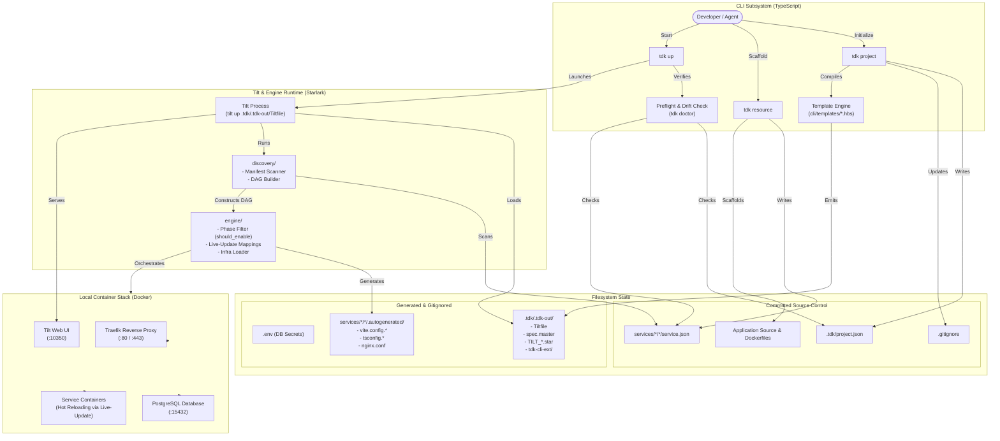

# Architecture: How TDK Works End to End

TDK bridges high-level architectural intent and local container runtime orchestration. Instead of hand-crafting complex Docker Compose files or maintaining local Kubernetes manifests, developers declare services using simple `service.json` manifests alongside a `.tdk/project.json` project configuration. TDK then compiles, coordinates, and manages the local runtime through [Tilt](https://tilt.dev).

This document explains how TDK's subsystems fit together, traces the data flow of a session from initialization to running containers, defines state boundaries, and serves as a roadmap for contributors making changes across the codebase.

---

## 1. The Three Subsystems

The codebase is organized into three distinct subsystems as defined in [CONTRIBUTING.md](../CONTRIBUTING.md):

```
tdk-cli-core/
├── cli/           # TypeScript CLI (user interaction, validation, config generation)
├── engine/        # Starlark runtime framework executed by Tilt (orchestration, containers, syncs)
└── discovery/     # Starlark discovery framework (manifest scanning, DAG construction)
```

### `cli/` — The TypeScript CLI
- **What it is responsible for**: `cli/` provides the developer entry point. It parses CLI flags and subcommands via Commander, executes interactive prompts and TUI dashboards (using Ink), validates `project.json` and `service.json` manifests against JSON Schemas, manages deterministic port allocations across ranges, evaluates Handlebars templates to produce master configuration files in `.tdk/.tdk-out/`, vendors engine and discovery assets, and launches and supervises Tilt processes (`tilt up`, `tilt down`, readiness detection, and `tdk doctor` environment diagnostics).
- **What it must NOT do**: `cli/` must **not** make dynamic container orchestration decisions at runtime (such as watching source files for container live-updates, evaluating dependency DAGs, or triggering image rebuilds). It must **not** bypass Tilt to start containers directly for managed service resources, and it must **not** hardcode application-specific service topologies or business logic.

### `engine/` — The Starlark Runtime Framework
- **What it is responsible for**: `engine/` is written in Starlark and executes directly inside Tilt when Tilt loads the generated `Tiltfile`. It translates the normalized resource models and project specifications into native Tilt API directives (`docker_build`, `custom_build`, `dc_resource`, `local_resource`, and `live_update`). It defines container lifecycles, healthcheck probes, entrypoints, live-update sync rules (reloading source files into containers without slow image rebuilds), Traefik reverse proxy routing, shared platform databases (such as PostgreSQL via `database-management`), wake-gateways, and phase-based enablement filters (`should_enable()`).
- **What it must NOT do**: `engine/` must **not** parse command-line arguments, run interactive user prompts, modify committed user source files or manifests on disk, or perform ad-hoc filesystem scanning outside the discovery contract.

### `discovery/` — Manifest Scanning & Dependency Graph Construction
- **What it is responsible for**: `discovery/` is a Starlark-based subsystem that scans project directories along configured discovery paths (by default `services/*/*`), parses discovered `service.json` files, validates them against platform rules, and synthesizes missing defaults (such as default sync directories, ports, and stack associations). It resolves inter-service dependencies (`dependsOn`) to construct a directed acyclic graph (DAG) and exports clean, immutable registry structures (`APP_RESOURCES`, `INFRA_RESOURCES_EXPORT`, `Registry`) for the engine to consume.
- **What it must NOT do**: `discovery/` must **not** execute build commands, start containers, manage runtime process lifecycles, configure live-update sync rules, or mutate user files on disk.

---

## 2. Session Data Flow

A typical TDK session progresses through three distinct stages: project initialization (`tdk project`), service scaffolding (`tdk resource`), and runtime launch (`tdk up`).

### Step 1: `tdk project` (Project Initialization)
1. **Manifest Creation**: Writes the root `.tdk/project.json` file defining project identity, release phases (`pre_alpha`, `alpha`, `beta`, `out_of_scope`), enabled stacks, optional infrastructure, and discovery paths.
2. **Git Hygiene**: Calls `ensureGitignore()` (in [cli/src/utils/file-helpers.ts](../cli/src/utils/file-helpers.ts)) to append required gitignore patterns (`.env`, `.tdk/.tdk-out/`, `.tdk/.project-id`, `.tdk/smoke/`, `node_modules/`) so secrets and generated assets are never committed.
3. **Master Config Generation**: Compiles Handlebars templates from [cli/templates/](../cli/templates/) through `generateMasterConfigs()` in [cli/src/generator/template-engine.ts](../cli/src/generator/template-engine.ts) and emits them into the gitignored `.tdk/.tdk-out/` directory:
   - `Tiltfile`: The main entry point loaded by Tilt.
   - `TILT_TECH_STACK.star`: Technology standards, port ranges, and healthcheck routes.
   - `TILT_RESOURCE_DEFAULTS.star`: Defaults and conventions per resource type.
   - `spec.master`: Active phases and enabled stack declarations.
   - `.tiltignore`: Ignore rules copied to the project root so Tilt ignores non-runtime files.
4. **Extension Vendoring**: Vendors a self-contained copy of `engine/`, `discovery/`, `specs/`, and `ext/` into `.tdk/.tdk-out/tdk-cli-ext/`, ensuring `tdk up` functions offline without external git dependencies.

### Step 2: `tdk resource` (Service Scaffolding)
1. **Validation**: Validates the resource name and target stack (enforcing kebab-case conventions).
2. **Port Allocation**: Assigns an unused, non-conflicting local port from the designated `PORT_RANGES` based on the resource type (`frontend`, `backend`, `worker`, `agent`, etc.).
3. **Manifest & Source Scaffolding**: Creates the resource directory under the discovery path (e.g., `services/<stack>/<resource>/`) containing:
   - `service.json`: The committed declarative manifest (specifying `appType`, `port`, `dependsOn`, `features`, `build`, and `dev` configuration).
   - Service source code: Language and framework boilerplate (`src/index.ts`, `package.json`, `tsconfig.json`, `Dockerfile`, unit tests) provided by backend language providers or frontend framework providers.

### Step 3: `tdk up` (Runtime Execution)
1. **Preflight & Drift Verification**: Verifies environment readiness (Docker running, WSL2 on Windows). `tdk up` runs the full runtime preflight; `tdk project` only checks the prerequisites that writing files needs, so project setup works without a Docker daemon or Tilt. Re-runs `generateMasterConfigs()` if manifests changed, and checks for manual edits to generated files to prevent drift.
2. **Tilt Launch**: Spawns `tilt up` targeting the generated `.tdk/.tdk-out/Tiltfile`.
3. **Starlark Discovery & DAG Assembly**: Inside Tilt, `Tiltfile` imports `discovery/` from the vendored extension. `discovery/` traverses all paths matching `services/*/*/service.json`, synthesizes missing defaults, and builds the resource DAG.
4. **Engine Orchestration**: `engine/` evaluates phase filters against `spec.master` via `should_enable()`. For each enabled resource:
   - Generates service runtime files under `services/<stack>/<resource>/.autogenerated/` (such as `nginx.autogenerated.conf`, `vite.config.*`, `tsconfig.autogenerated.json`, or generated Dockerfiles).
   - Registers Tilt build targets (`docker_build` with `live_update` sync mappings).
   - Launches shared platform infrastructure (Traefik reverse proxy on port 80/443, PostgreSQL database on port 15432).
5. **Runtime Supervision**: Tilt builds images, boots containers in dependency order, forwards ports, wires Traefik routing rules, and launches the interactive Tilt web UI (default `http://localhost:10350`). The CLI monitors startup readiness and prints accessible service URLs.
6. **Smoke Checks**: For services that declare a `smoke` block, `tdk up` requests the public URL it prints once Tilt reports readiness. Before the first response record is written, it makes sure the project `.gitignore` ignores `.tdk/smoke/` (through `ensureSmokeRecordsIgnored()` in [cli/src/utils/file-helpers.ts](../cli/src/utils/file-helpers.ts)), and it masks the project's own `.env` secret values out of every text it shows or stores.

---

## 3. Architecture & Data Flow Diagram



---

## 4. Where State Lives: Committed vs. Generated

TDK maintains a strict boundary between what belongs in source control and what is ephemeral or generated.

| Artifact Path | Classification | Purpose | Why This Boundary Matters |
| :--- | :--- | :--- | :--- |
| `.tdk/project.json` | **Committed** | Project identity, enabled phases/stacks, discovery paths. | Shared team source of truth for repository architecture. |
| `services/*/*/service.json` | **Committed** | Declarative service manifests (appType, port, dependencies, features). | Defines service contracts; checked in alongside code. |
| Application source code (`src/`, `package.json`, `Dockerfile`) | **Committed** | Business logic, application packages, and custom build definitions. | Standard version-controlled project source. |
| `.gitignore` | **Committed** | Git exclusion rules. | Maintained by `ensureGitignore()` to prevent accidental check-in of secrets or outputs. |
| `.tiltignore` | **Committed** | Patterns ignored by Tilt file watches. | Prevents Tilt loops on logs, coverage, and cache artifacts. |
| `.env` | **Generated / Gitignored** | Local environment variables and generated database credentials (`DB_PASSWORD`). | **Security boundary**: Contains auto-generated passwords; must never be committed. |
| `.tdk/.tdk-out/` | **Generated / Gitignored** | Generated `Tiltfile`, `spec.master`, `TILT_*.star`, and vendored `tdk-cli-ext/`. | Derived entirely from `project.json` and CLI templates; rebuilt automatically. |
| `.tdk/.project-id` | **Generated / Gitignored** | Ephemeral internal project identifier. | Local machine state. |
| `.tdk/smoke/` | **Generated / Gitignored** | Output from `tdk up` smoke checks. | Ephemeral test artifacts. |
| `services/*/*/.autogenerated/` | **Generated / Gitignored** | Nginx configs, dev/build Vite configs, container tsconfigs, and service snapshots. | Generated directly by Starlark engine during Tilt execution. Protected against manual edits by drift detection. |
| `node_modules/` | **Gitignored** | Local dependency packages. | Standard package manager artifact. |

For a complete breakdown of files generated within individual service folders, see [Generated Service Files](generated-files.md).

---

## 5. "Where Do I Make a Change for X?"

Use this reference table to find the right files, tests, and documentation when making changes:

| What You Want to Change | Primary Code Locations | Tests & Verification | Documentation to Update |
| :--- | :--- | :--- | :--- |
| **New CLI command or option** | `cli/src/commands/<command>.ts`<br/>Register in `cli/src/cli.ts` | `cli/src/commands/__tests__/<command>.test.ts`<br/>`bun run test` | `cli/README.md`<br/>`docs/cheat-sheet.md` |
| **New resource type** | `cli/src/types/index.ts` (`ResourceType`)<br/>`cli/src/commands/resource.ts`<br/>`engine/schemas/service-schema.json`<br/>`discovery/manifest/normalize.star` | `cli/src/commands/__tests__/resource.test.ts`<br/>`make test-shell`<br/>Add e2e suite in `tests/e2e/resource-types/` | `docs/service-json.md`<br/>`docs/layout.md` |
| **New backend language provider** | `cli/src/backend-languages/<lang>.ts`<br/>Register in `cli/src/backend-languages/registry.ts`<br/>`engine/topologies/platform/docker/dockerfile/language_dockerfile.star`<br/>`engine/topologies/tilt/generators/validators.star` | Provider tests in `cli/src/backend-languages/__tests__/`<br/>`make test-ts`<br/>E2E test in `tests/e2e/resource-types/backend/` | `docs/backend-language-providers.md` |
| **New frontend framework provider** | `cli/src/frontend-frameworks/<framework>.ts`<br/>Register in `cli/src/frontend-frameworks/registry.ts`<br/>`engine/topologies/tilt/generators/vite_config.star` | `cli/src/frontend-frameworks/__tests__/`<br/>`make test-ts` | `docs/frontend-framework-providers.md` |
| **Master config template or project template** | `cli/templates/<template>.hbs`<br/>`cli/src/generator/template-engine.ts`<br/>`cli/src/utils/project-templates.ts` | `cli/src/generator/__tests__/template-engine.test.ts`<br/>`bun run test` | `docs/configuration.md` |
| **Doctor check or preflight rule** | `cli/src/utils/doctor-report.ts`<br/>`cli/src/utils/doctor-runtime.ts`<br/>`cli/src/commands/doctor.ts` | `cli/src/utils/__tests__/doctor-report.test.ts`<br/>`cli/src/commands/__tests__/doctor.test.ts` | `docs/reference/doctor-contract.md`<br/>`docs/troubleshooting.md` |
| **Engine container orchestration or live-update** | `engine/topologies/tilt/resources/`<br/>`engine/topologies/platform/docker/`<br/>`engine/topologies/tilt/generators/` | Try with `tilt alpha tiltfile-result -f try.Tiltfile`<br/>`tests/tilt-engine/`<br/>`make test-python` | `docs/TOPOLOGY.md`<br/>`docs/generated-files.md` |
| **Service discovery or manifest parsing** | `discovery/manifest/loading.star`<br/>`discovery/manifest/normalize.star`<br/>`discovery/discovery_orchestrator.star` | `cli/src/commands/__tests__/discovery-*.test.ts`<br/>`make test-shell` | `docs/service-json.md`<br/>`docs/configuration.md` |
| **Shared infrastructure (Postgres, Traefik, etc.)** | `engine/topologies/tilt/resources/infra-loader.star`<br/>`engine/topologies/tilt/resources/databases.star`<br/>`engine/topologies/platform/docker/compose/` | `tests/tilt-engine/`<br/>E2E tests in `tests/e2e/` | `docs/FEATURES.md`<br/>`docs/data.md` |

---

## 6. Further Reading

- [Contributor Guide](contributing/README.md): Quickstart setup, Dev Containers, and opening pull requests.
- [Feature Recipes](contributing/02-feature-recipes.md): Step-by-step recipes for specific contributor tasks.
- [Writing an E2E Test](contributing/05-write-e2e.md): How and when to write live stack tests.
- [Topology Overview](TOPOLOGY.md): In-depth look at Tilt resources, live-update sync mechanics, and container topology.
- [Configuration Reference](configuration.md): Complete guide to `project.json` and `service.json` schema specifications.
