# TDK CLI — ノートPCでサービスを起動する

[English](../README.md) | [简体中文](README-zh_cn.md) | [繁體中文](README-zh_tw.md) | 日本語 | [한국어](README-ko.md)

TDK CLI は、ノートPC上でサービスを起動します。デプロイツールでも Compose ファイルでもありません。各サービスを `service.json` で定義し、`tdk up` を実行するだけです。マシンに Kubernetes は不要です。

安定性: 1.x のローカル開発向け。生成されるファイルは契約として扱われ、`tdk config verify` で検証できます。コア CLI は MIT ライセンスでキーは不要です。Premium は任意です。

コンテナは Docker が実行します。Tilt はサービスを監視し、コーディング中にコンテナをライブアップデートします。TDK CLI は Tilt が使う設定を書き出します。本番デプロイは引き続き Helm、Argo CD、Kustomize が担当します。

[ウェブサイト](https://tdk-landscape.github.io/tdk-website/) · [クイックスタート](https://tdk-landscape.github.io/tdk-website/docs/quickstart/) · [サンプル](https://tdk-landscape.github.io/tdk-website/docs/examples/) · [Awesome TDK](https://github.com/tdk-landscape/awesome-tdk-framework) · [デモ](https://tdk-landscape.github.io/tdk-demo-animation/) · [バグ報告](https://github.com/tdk-landscape/tdk-cli-core/issues)

TDK でローカルのサービス構成を動かしているなら、[このリポジトリ](https://github.com/tdk-landscape/tdk-cli-core) に ⭐ をつけていただくと、ほかの開発者が見つけやすくなります。

## なぜ TDK CLI なのか

- **サービスごとに `service.json` を 1 つ。** TDK はそこから Dockerfile、Traefik のルーティング、Tiltfile を生成します。`docker-compose.yml` や `nginx.conf` を手書きする必要はありません。
- **Kubernetes を使わないローカル構成。** サービスは Docker と Tilt で手元のマシン上に起動します。kind や minikube のようなローカルクラスタは不要です。
- **コーディング中のホットリロード。** ファイルを変更すると、Tilt がコンテナをライブ更新します。
- **確認できる生成ファイル。** `tdk` は生成されたファイルを記録し、ドリフトを報告するので、ローカルの設定を定義と一致させたままにできます。詳しくは [生成ファイルとドリフトチェック](generated-files.md) を参照してください。

## TDK を使っているチーム

まだ掲載されているチームはありません。最初の一組になりませんか。[TDK を使っていることを知らせる](https://github.com/tdk-landscape/tdk-cli-core/issues/new?template=we-use-tdk.yml)か、[ADOPTERS.md](../ADOPTERS.md) に行を追加してください。

## クイックスタート

```bash
mkdir shop && cd shop
tdk project --yes
tdk resource orders-api --type backend --stack shop --yes
tdk up shop
curl http://api.shop.localhost:8080/api/orders/health
```



*バックエンドとフロントエンドをスキャフォールドし、スタックを一覧表示します。*


Helm、Compose、既存の Tilt 構成でローカル環境がすでに問題なく動いているなら、そのまま使い続けてください。TDK CLI は、複数のサービスを扱い、明確なローカルサービス契約と、スタックを起動する1つのコマンドを求めるエンジニア向けです。

[Helm との併用方法](https://tdk-landscape.github.io/tdk-website/docs/with-helm/)、[サービススキーマ](../engine/schemas/service-schema.json)、[プロジェクト設定スキーマ](../engine/schemas/project-schema.json)も参照してください。

[](https://www.npmjs.com/package/@tdk-landscape/tdk-cli-core)
[](https://github.com/tdk-landscape/tdk-cli-core/actions/workflows/ci.yml)
[](https://github.com/tdk-landscape/tdk-cli-core/actions/workflows/e2e-journeys.yml)
[](https://github.com/tdk-landscape/tdk-cli-core/actions/workflows/e2e-scale.yml)
[](https://github.com/tdk-landscape/tdk-cli-core/actions/workflows/e2e-examples.yml)
[](https://snyk.io/test/github/tdk-landscape/tdk-cli-core)
[](https://socket.dev/npm/package/@tdk-landscape/tdk-cli-core/overview)
[](../LICENSE)

## インストール

npm から CLI をインストールするか（Node.js 22.12+ が必要）、ビルド済みバイナリを使用します（Node.js も Bun も不要）。

```bash
npm install -g @tdk-landscape/tdk-cli-core
# or install the prebuilt binary
curl -fsSL https://tdk-landscape.github.io/install.sh | sh
```

`tdk up shop --dry-run` は、コンテナを起動する前に、選択されたローカルサービスと URL をプレビューします。デフォルトのスターターは Bun/TypeScript です。TDK の中核的な役割は Docker + Tilt でローカルコンテナを実行することであり、Node.js アプリケーションフレームワークを提供することではありません。[単一バックエンドのサンプル](../examples/one-backend/README.md)を参照してください。

## TDK を使わないほうがよい場合

- 既存の Compose や Tilt のワークフローでローカル環境がすでに問題なく動いている。
- 開発ワークフロー全体が Helm で完結しており、ローカルサービスを Docker 上で動かしたくない。
- `service.json` マニフェストと生成されるローカル設定を使いたくない。

## ドキュメント

- [ドキュメント索引](README.md)
- [Helm との併用](with-helm.md)
- [設定とエディタ用スキーマ](configuration.md)
- [実行可能な単一バックエンドのサンプル](../examples/one-backend/README.md)
- [実行可能な Python バックエンドのサンプル](../examples/one-backend-python/README.md)
- [マルチサービスの完全なサンプル](../examples/tdk-example/README.md)
- [機能とライセンス上の制限](FEATURES.md)
- [率直な比較と既知の制限](compare-honest.md)
- [公開している主張の一覧](claims.md)
- [Show HN の下書き](drafts/show-hn.md)
- [アーキテクチャとリポジトリマップ](project-overview.md)
- [スケールフィクスチャの計測結果と注意点](benchmarks/scale-bench.md)

## 経緯

TDK は、このリポジトリや npm パッケージの日付から想像されるよりも前から存在します。開発は 2026年4月21日に [tdk-landscape/tdk](https://github.com/tdk-landscape/tdk) で始まり、同リポジトリは現在アーカイブされ、読み取り専用の履歴として残されています。最初のコミットは [`1714637`](https://github.com/tdk-landscape/tdk/commit/1714637637196ed54cbfa18534230a782c05ab36)（"Initial commit: TDK specs, generators, CLI, and standards"）です。このリポジトリ `tdk-cli-core` は 2026年9月19日に作成され、開発はここで続いています。npm の `@tdk-landscape/tdk-cli-core` パッケージは 2026年9月21日に初めて公開されました。そのため、コードの系譜は、GitHub や npm で見えるリポジトリやパッケージの日付より約5か月古いことになります。

## 要件とサポート

ローカルランタイムには、Docker（Desktop、OrbStack、または Colima。Engine 25+、Compose 2.20.2+）と [Tilt](https://docs.tilt.dev/install.html) をインストールしてください。デフォルトで生成されるサービスは Bun 1.2+ を使用します。TDK は HTTP、HTTPS、Postgres のホストポートを、範囲が限られたフォールバック範囲から選びます。上書きするには `TDK_HTTP_PORT`、`TDK_HTTPS_PORT`、`TDK_POSTGRES_PORT` を設定してください。TDK は macOS、Linux、および WSL2 Ubuntu 経由の Windows をサポートします。ネイティブ Windows では CLI の確認のみ可能です。`tdk doctor` を実行してローカルの準備状況を確認してください。[WSL2 のセットアップ](wsl2.md)を参照してください。

ネイティブ Windows では、`tdk --version`、`tdk doctor`、`tdk up --dry-run` は確認専用のコマンドです。`tdk up` は終了コード 2 で終了し、「Landscape startup needs Ubuntu on WSL2. Native Windows is inspect-only.」と表示します。

## ライセンス対応表

| 機能 | 無料 | Premium |
| --- | --- | --- |
| `tdk up`、スキャフォールド、Traefik、Postgres、Tilt ライブアップデート、golden layers | あり | あり |
| Verdaccio、DDD スキャフォールド、Sablier アイドル停止 | なし | キーが必要 |
| Playwright、C4、AGENTS.md | リポジトリ内で生成する場合は無料 | キーで実装をダウンロードした場合のみ |

コアは無料のままです。Premium は上記の追加機能のための別キーであり、`tdk up` の実行にキーは不要です。

**エコシステムマップ:** サンプル、記事、関連ツール、メモは [awesome-tdk-framework](https://github.com/tdk-landscape/awesome-tdk-framework) にあります。実際に使っているのがこの CLI であれば、このリポジトリ（`tdk-cli-core`）にスターを付けてください。それ以外は awesome リストから探せます。

**共有:** [X](https://twitter.com/intent/tweet?text=TDK%20CLI%20%E3%82%92%E4%BD%BF%E3%81%A3%E3%81%A6%E3%80%81%E3%82%B3%E3%83%9E%E3%83%B3%E3%83%891%E3%81%A4%E3%81%A7%E3%83%AD%E3%83%BC%E3%82%AB%E3%83%AB%E3%81%AE%E3%82%B5%E3%83%BC%E3%83%93%E3%82%B9%E3%82%92%E8%B5%B7%E5%8B%95%E3%81%A7%E3%81%8D%E3%81%BE%E3%81%97%E3%81%9F%E3%80%82%E3%81%A8%E3%81%A6%E3%82%82%E8%89%AF%E3%81%84%E3%81%A7%E3%81%99%EF%BC%81%E7%84%A1%E6%96%99%E3%81%A7%E3%82%AA%E3%83%BC%E3%83%97%E3%83%B3%E3%82%BD%E3%83%BC%E3%82%B9%E3%81%A7%E3%81%99%E3%80%82%E3%81%93%E3%81%A1%E3%82%89%E3%81%8B%E3%82%89%E3%81%A9%E3%81%86%E3%81%9E%3A&url=https%3A%2F%2Fgithub.com%2Ftdk-landscape%2Ftdk-cli-core) · [Bluesky](https://bsky.app/intent/compose?text=TDK%20CLI%20%E3%82%92%E4%BD%BF%E3%81%A3%E3%81%A6%E3%80%81%E3%82%B3%E3%83%9E%E3%83%B3%E3%83%891%E3%81%A4%E3%81%A7%E3%83%AD%E3%83%BC%E3%82%AB%E3%83%AB%E3%81%AE%E3%82%B5%E3%83%BC%E3%83%93%E3%82%B9%E3%82%92%E8%B5%B7%E5%8B%95%E3%81%A7%E3%81%8D%E3%81%BE%E3%81%97%E3%81%9F%E3%80%82%E3%81%A8%E3%81%A6%E3%82%82%E8%89%AF%E3%81%84%E3%81%A7%E3%81%99%EF%BC%81%E7%84%A1%E6%96%99%E3%81%A7%E3%82%AA%E3%83%BC%E3%83%97%E3%83%B3%E3%82%BD%E3%83%BC%E3%82%B9%E3%81%A7%E3%81%99%E3%80%82%E3%81%93%E3%81%A1%E3%82%89%E3%81%8B%E3%82%89%E3%81%A9%E3%81%86%E3%81%9E%3A%20https%3A%2F%2Fgithub.com%2Ftdk-landscape%2Ftdk-cli-core) · [Threads](https://www.threads.net/intent/post?text=TDK%20CLI%20%E3%82%92%E4%BD%BF%E3%81%A3%E3%81%A6%E3%80%81%E3%82%B3%E3%83%9E%E3%83%B3%E3%83%891%E3%81%A4%E3%81%A7%E3%83%AD%E3%83%BC%E3%82%AB%E3%83%AB%E3%81%AE%E3%82%B5%E3%83%BC%E3%83%93%E3%82%B9%E3%82%92%E8%B5%B7%E5%8B%95%E3%81%A7%E3%81%8D%E3%81%BE%E3%81%97%E3%81%9F%E3%80%82%E3%81%A8%E3%81%A6%E3%82%82%E8%89%AF%E3%81%84%E3%81%A7%E3%81%99%EF%BC%81%E7%84%A1%E6%96%99%E3%81%A7%E3%82%AA%E3%83%BC%E3%83%97%E3%83%B3%E3%82%BD%E3%83%BC%E3%82%B9%E3%81%A7%E3%81%99%E3%80%82%E3%81%93%E3%81%A1%E3%82%89%E3%81%8B%E3%82%89%E3%81%A9%E3%81%86%E3%81%9E%3A%20https%3A%2F%2Fgithub.com%2Ftdk-landscape%2Ftdk-cli-core) · [Mastodon](https://mastodon.social/share?text=TDK%20CLI%20%E3%82%92%E4%BD%BF%E3%81%A3%E3%81%A6%E3%80%81%E3%82%B3%E3%83%9E%E3%83%B3%E3%83%891%E3%81%A4%E3%81%A7%E3%83%AD%E3%83%BC%E3%82%AB%E3%83%AB%E3%81%AE%E3%82%B5%E3%83%BC%E3%83%93%E3%82%B9%E3%82%92%E8%B5%B7%E5%8B%95%E3%81%A7%E3%81%8D%E3%81%BE%E3%81%97%E3%81%9F%E3%80%82%E3%81%A8%E3%81%A6%E3%82%82%E8%89%AF%E3%81%84%E3%81%A7%E3%81%99%EF%BC%81%E7%84%A1%E6%96%99%E3%81%A7%E3%82%AA%E3%83%BC%E3%83%97%E3%83%B3%E3%82%BD%E3%83%BC%E3%82%B9%E3%81%A7%E3%81%99%E3%80%82%E3%81%93%E3%81%A1%E3%82%89%E3%81%8B%E3%82%89%E3%81%A9%E3%81%86%E3%81%9E%3A%20https%3A%2F%2Fgithub.com%2Ftdk-landscape%2Ftdk-cli-core) · [Reddit](https://www.reddit.com/submit?title=TDK%20CLI%3A%20%E3%82%B3%E3%83%9E%E3%83%B3%E3%83%891%E3%81%A4%E3%81%A7%E3%83%AD%E3%83%BC%E3%82%AB%E3%83%AB%E3%82%B5%E3%83%BC%E3%83%93%E3%82%B9%E3%82%92%E8%B5%B7%E5%8B%95&url=https%3A%2F%2Fgithub.com%2Ftdk-landscape%2Ftdk-cli-core) · [Hacker News](https://news.ycombinator.com/submitlink?u=https%3A%2F%2Fgithub.com%2Ftdk-landscape%2Ftdk-cli-core&t=TDK%20CLI%3A%20%E3%82%B3%E3%83%9E%E3%83%B3%E3%83%891%E3%81%A4%E3%81%A7%E3%83%AD%E3%83%BC%E3%82%AB%E3%83%AB%E3%82%B5%E3%83%BC%E3%83%93%E3%82%B9%E3%82%92%E8%B5%B7%E5%8B%95) · [Facebook](https://www.facebook.com/sharer/sharer.php?u=https%3A%2F%2Fgithub.com%2Ftdk-landscape%2Ftdk-cli-core) · [LinkedIn](https://www.linkedin.com/sharing/share-offsite/?url=https%3A%2F%2Fgithub.com%2Ftdk-landscape%2Ftdk-cli-core&mini=true&title=TDK%20CLI%3A%20%E3%82%B3%E3%83%9E%E3%83%B3%E3%83%891%E3%81%A4%E3%81%A7%E3%83%AD%E3%83%BC%E3%82%AB%E3%83%AB%E3%82%B5%E3%83%BC%E3%83%93%E3%82%B9%E3%82%92%E8%B5%B7%E5%8B%95&summary=TDK%20CLI%20%E3%82%92%E4%BD%BF%E3%81%A3%E3%81%A6%E3%80%81%E3%82%B3%E3%83%9E%E3%83%B3%E3%83%891%E3%81%A4%E3%81%A7%E3%83%AD%E3%83%BC%E3%82%AB%E3%83%AB%E3%81%AE%E3%82%B5%E3%83%BC%E3%83%93%E3%82%B9%E3%82%92%E8%B5%B7%E5%8B%95%E3%81%A7%E3%81%8D%E3%81%BE%E3%81%97%E3%81%9F%E3%80%82%E7%84%A1%E6%96%99%E3%81%A7%E3%82%AA%E3%83%BC%E3%83%97%E3%83%B3%E3%82%BD%E3%83%BC%E3%82%B9%E3%81%A7%E3%81%99%E3%80%82) · [Telegram](https://t.me/share/url?url=https%3A%2F%2Fgithub.com%2Ftdk-landscape%2Ftdk-cli-core&text=TDK%20CLI%20%E3%82%92%E4%BD%BF%E3%81%A3%E3%81%A6%E3%80%81%E3%82%B3%E3%83%9E%E3%83%B3%E3%83%891%E3%81%A4%E3%81%A7%E3%83%AD%E3%83%BC%E3%82%AB%E3%83%AB%E3%81%AE%E3%82%B5%E3%83%BC%E3%83%93%E3%82%B9%E3%82%92%E8%B5%B7%E5%8B%95%E3%81%A7%E3%81%8D%E3%81%BE%E3%81%97%E3%81%9F%E3%80%82%E3%81%A8%E3%81%A6%E3%82%82%E8%89%AF%E3%81%84%E3%81%A7%E3%81%99%EF%BC%81%E7%84%A1%E6%96%99%E3%81%A7%E3%82%AA%E3%83%BC%E3%83%97%E3%83%B3%E3%82%BD%E3%83%BC%E3%82%B9%E3%81%A7%E3%81%99%E3%80%82%E3%81%93%E3%81%A1%E3%82%89%E3%81%8B%E3%82%89%E3%81%A9%E3%81%86%E3%81%9E%3A) · [WhatsApp](https://wa.me/?text=TDK%20CLI%20%E3%82%92%E4%BD%BF%E3%81%A3%E3%81%A6%E3%80%81%E3%82%B3%E3%83%9E%E3%83%B3%E3%83%891%E3%81%A4%E3%81%A7%E3%83%AD%E3%83%BC%E3%82%AB%E3%83%AB%E3%81%AE%E3%82%B5%E3%83%BC%E3%83%93%E3%82%B9%E3%82%92%E8%B5%B7%E5%8B%95%E3%81%A7%E3%81%8D%E3%81%BE%E3%81%97%E3%81%9F%E3%80%82%E3%81%A8%E3%81%A6%E3%82%82%E8%89%AF%E3%81%84%E3%81%A7%E3%81%99%EF%BC%81%E7%84%A1%E6%96%99%E3%81%A7%E3%82%AA%E3%83%BC%E3%83%97%E3%83%B3%E3%82%BD%E3%83%BC%E3%82%B9%E3%81%A7%E3%81%99%E3%80%82%E3%81%93%E3%81%A1%E3%82%89%E3%81%8B%E3%82%89%E3%81%A9%E3%81%86%E3%81%9E%3A%20https%3A%2F%2Fgithub.com%2Ftdk-landscape%2Ftdk-cli-core) · [Email](mailto:?subject=TDK%20CLI%3A%20%E3%82%B3%E3%83%9E%E3%83%B3%E3%83%891%E3%81%A4%E3%81%A7%E3%83%AD%E3%83%BC%E3%82%AB%E3%83%AB%E3%82%B5%E3%83%BC%E3%83%93%E3%82%B9%E3%82%92%E8%B5%B7%E5%8B%95&body=TDK%20CLI%20%E3%82%92%E4%BD%BF%E3%81%A3%E3%81%A6%E3%80%81%E3%82%B3%E3%83%9E%E3%83%B3%E3%83%891%E3%81%A4%E3%81%A7%E3%83%AD%E3%83%BC%E3%82%AB%E3%83%AB%E3%81%AE%E3%82%B5%E3%83%BC%E3%83%93%E3%82%B9%E3%82%92%E8%B5%B7%E5%8B%95%E3%81%A7%E3%81%8D%E3%81%BE%E3%81%97%E3%81%9F%E3%80%82%E3%81%A8%E3%81%A6%E3%82%82%E8%89%AF%E3%81%84%E3%81%A7%E3%81%99%EF%BC%81%E7%84%A1%E6%96%99%E3%81%A7%E3%82%AA%E3%83%BC%E3%83%97%E3%83%B3%E3%82%BD%E3%83%BC%E3%82%B9%E3%81%A7%E3%81%99%E3%80%82%E3%81%93%E3%81%A1%E3%82%89%E3%81%8B%E3%82%89%E3%81%A9%E3%81%86%E3%81%9E%3A%20https%3A%2F%2Fgithub.com%2Ftdk-landscape%2Ftdk-cli-core)

## コントリビューションとライセンス

コントリビューションを歓迎します。まず [コントリビュートガイド（日本語）](contributing/translations/CONTRIBUTING-ja.md) と[コントリビューターガイド](contributing/README.md)をご覧ください。pull request をレビューするには [pull request をレビューする](contributing/04-review-a-pr.md)（英語）をご覧ください。セキュリティ上の問題は [SECURITY.md](../SECURITY.md) に従って報告してください。

TDK は MIT ライセンスです。[LICENSE](../LICENSE) を参照してください。
