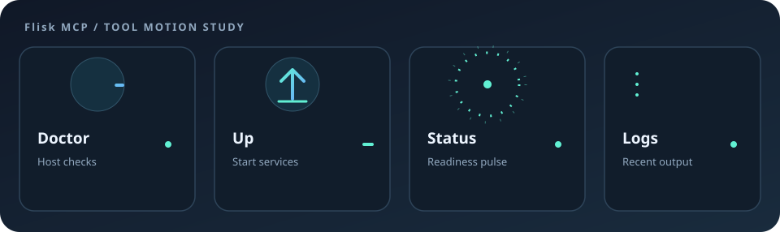

# TDK agent tooling

The TDK CLI ships a local Model Context Protocol (MCP) server, `tdk mcp`. Your MCP client starts it as a child process and talks to it over stdio on your machine. It is not a hosted endpoint, and there is no separate MCP package or server to install.

- [Set up the TDK MCP server](tdk-mcp-setup.md): install TDK, point Codex, Claude Code, Claude Desktop, or Cursor at `tdk mcp`, and run `doctor` then `up` for the first time. Start here if no client can call TDK yet.
- [TDK MCP quick guide](tdk-mcp.md): what each tool does and how to call it once the server is connected.

You can ask for operations in plain language; you do not need to write JavaScript or call the tools by name.

## The tools at a glance

The server exposes nine tools: `doctor`, `up`, `down`, `status`, `logs`, `resource_list`, `restart_resource`, `list_agents`, and `get_agent_sessions`. The [setup guide](tdk-mcp-setup.md#the-tools) says what each one does and when to use it.

## Reporting problems found while using the TDK MCP

TDK is open source. When an agent or a person using `tdk mcp` hits a framework problem, open an issue in [tdk-landscape/tdk-cli-core](https://github.com/tdk-landscape/tdk-cli-core/issues) with the tdk version, a minimal reproduction, and the expected behavior. If you have a fix, open a pull request against the same repository.

Example: [#1204](https://github.com/tdk-landscape/tdk-cli-core/issues/1204) reports that `tdk project` output under `.tdk/.tdk-out` is picked up by Vitest in Node and TypeScript projects.
