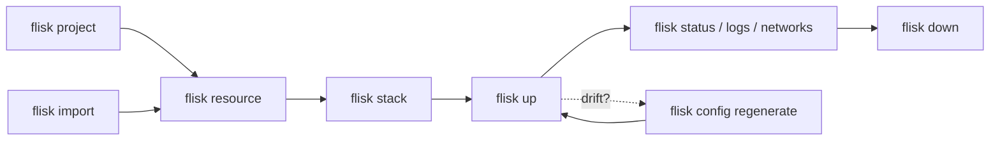

# ⚡ Flisk mega cheat sheet

> Every `flisk` command, alias and flag on one page. Taken from `flisk <command> --help` for **v1.3.125**. Your version may differ, so run `flisk <command> --help` to check.

**Jump to:** [🚀 Start](#-first-five-minutes) · [🔥 Top 10](#-top-10) · [🗺️ Map](#️-how-it-fits-together) · [🌍 Project](#-project) · [📦 Resources](#-resources) · [🗂️ Stacks](#️-stacks) · [▶️ Lifecycle](#️-lifecycle) · [⚙️ Config](#️-configuration) · [🩺 Diagnostics](#-diagnostics-and-tooling) · [🤖 JSON](#-json-output-and-exit-codes) · [🌱 Env](#-environment-variables) · [📁 Files](#-files-flisk-writes) · [🍳 Recipes](#-recipes)

Want the short version? See the [10-row cheat sheet](../cli/README.md#cheat-sheet).

> [!NOTE]
> Services that declare a `command` need only their own runtime ([without Docker](run-without-docker.md)). Container stacks need Docker (Engine 25+, Compose 2.20.2+), [Tilt](https://docs.tilt.dev/install.html), and Bun 1.2+ for the default generated services; on Windows, run those in WSL2 ([setup](wsl2.md)).

## 🚀 First five minutes

```bash
curl -fsSL https://flisk.sh/install.sh | sh   # install
flisk doctor                                                  # Docker, Tilt and Bun OK?
flisk project --yes                                           # create the project
flisk resource api --type backend --stack api --yes           # a Bun + Hono API
flisk resource web --type frontend --stack api --yes          # a React app
flisk up api                                                  # start the stack
flisk networks                                                # where is everything?
flisk down                                                    # stop it all
```

> [!TIP]
> Run `flisk` with no arguments for a quick readiness check. It exits 1 if your machine is not ready.

## 🔥 Top 10

| You want to… | Run |
| --- | --- |
| Start everything | `flisk up` |
| Start one service and what it needs | `flisk up --only orders-api` |
| Clone a repository and start it | `flisk up https://github.com/org/repo` |
| See what is running | `flisk status --tilt` |
| Get the URLs | `flisk networks --raw` |
| Read recent logs | `flisk logs -s orders-api --since 5m` |
| Add a service | `flisk resource <name> --type backend --yes` |
| Group services | `flisk stack api --resources a b --yes` |
| Fix "my machine is weird" | `flisk doctor` |
| Fix "generated files drifted" | `flisk config regenerate` |
| Stop everything | `flisk down` |

## 🗺️ How it fits together

A **project** holds **resources** (services). **Stacks** group resources so you start them together.



## ⬆️ Install and update

```bash
curl -fsSL https://flisk.sh/install.sh | sh
flisk upgrade                 # alias: flisk update
flisk upgrade --dry-run       # show what would change
flisk upgrade --force --yes   # reinstall even if already on latest, no prompt
flisk version                 # aliases: flisk v, flisk -v, flisk --version
```

## 🌐 Global options

| Flag | Effect |
| --- | --- |
| `-v`, `--version` | Print the version |
| `--verbose` | Verbose output |
| `-h`, `--help` | Help. `flisk help <command>` works too |
| `flisk --doctor` | Same as `flisk doctor` |

## 📋 Commands at a glance

| Command | Aliases | What it does |
| --- | --- | --- |
| `flisk create [name]` | | Pick what you are building with a few key presses and get a project that runs |
| `flisk project [template]` | `init` | Create or check the project's master configs, or clone a starter |
| `flisk projects` | `info` | Show project info and config status |
| `flisk import [dir]` | | Import the services in a directory's root `docker-compose.yml` |
| `flisk import tiltfile [path]` | | Make `flisk up` run an existing Tiltfile without changing it |
| `flisk eject` | | Write `EJECTED.md` describing the generated Tilt files |
| `flisk repos clone` | | Clone the Git repositories listed in `.flisk/project.json` |
| `flisk resource [name]` | | Create a resource, or register an existing one |
| `flisk resources` | | List resources |
| `flisk stack [stack-name]` | | Assign resources to a stack |
| `flisk stacks` | `ls` | List stacks |
| `flisk up [stack-name \| git-url]` | `deploy` | Start services; a git URL is cloned into `./<repo>` first |
| `flisk down` | | Stop services |
| `flisk status` | | Show stack and service state |
| `flisk logs` | | Print recent logs from the running stack |
| `flisk run <service> -- <command>` | | Run a one-off command with the service environment (native runs use project `.env`, not `up --env-file`) |
| `flisk restart <resource>` | | Restart a running Tilt resource; for native services use `flisk down` then `flisk up` |
| `flisk networks` | `urls`, `traefik` | Show Traefik-routed URLs |
| `flisk open` | | Open the first frontend of the project in your browser |
| `flisk open --print` | | Print the first ready frontend URL without launching a browser |
| `flisk config <subcommand>` | | Regenerate, verify, migrate or edit project config |
| `flisk doctor` | | Check environment readiness |
| `flisk ui` | `interactive` | Interactive terminal UI |
| `flisk os` | | Start FliskOS, the local desktop app for projects and agents |
| `flisk mcp` | | MCP server over stdio for coding agents |
| `flisk connect <host>` | | Connect a coding agent to Flisk: write the flisk mcp server entry and the Flisk skills |
| `flisk agent sessions <resource>` | | List a running AI agent's sessions, or inspect one session's checkpoint |
| `flisk distribute <board\|kit\|status>` | | Board, listing kit and channel status for getting an app to users (local files only) |
| `flisk runtime` | | Inspect packaged engine and template assets |
| `flisk export <subcommand>` | | Write `render.yaml`, `wrangler.toml` or a standalone `docker-compose.yml` from `service.json`; never deploys or calls a cloud API |
| `flisk completion [shell]` | | Shell completion scripts |
| `flisk upgrade` | `update` | Self-update |
| `flisk version` | `v` | Print the version |
| `flisk maintainers check [file]` | | Check `MAINTAINERS.md` |

## 🌍 Project

### `flisk create [name]`

```bash
flisk create                           # interactive
flisk create my-app --yes              # defaults, no prompts
flisk create my-app --dry-run          # print the commands that would run
```

| Flag | Effect |
| --- | --- |
| `--starter <name>` | A ready-made starter project (see flisk project --list) |
| `--runtime <runtime>` | local (plain processes on your computer; default) or docker (Docker and Tilt) |
| `--frontend <id>` | Website framework (see flisk resource --frameworks --type frontend), or none |
| `--backend <id>` | API framework (see flisk resource --frameworks --type backend), or none |
| `--language <id>` | API language (see flisk resource --help) |
| `--extras <list>` | Docker runtime: extra parts, comma-separated (worker, queue:nats, database:redis…), or none |
| `--dry-run` | Print the commands that would run, and stop |
| `--start` | Install dependencies and start what was written. A local app runs with `flisk up`; a Docker app with `flisk up app`. A starter is never started here |
| `-y`, `--yes` | Skip prompts and confirmations; use defaults |

### `flisk project [template]` (alias: `flisk init`)

```bash
flisk project                          # interactive
flisk project --yes                    # defaults, no prompts
flisk project --check                  # do master configs exist and match?
flisk project --config-file cfg.json   # load project config from JSON
flisk project saas                     # clone a starter example
flisk project saas --path my-app       # clone into my-app/
flisk project next-postgres --path myapp  # Next.js + Express + Postgres with a migrator (needs Docker)
```

| Flag | Effect |
| --- | --- |
| `[template]` | Clone a starter instead of a blank project: `restaurant`, `saas`, `erp`, `user-management`, `ecommerce`, `example` |
| `--path <dir>` | Directory to clone the template into (default: the template's repo name) |
| `--check` | Check that master configs exist and are in sync |
| `--force` | Overwrite existing configuration ⚠️ destructive |
| `--yes` | Non-interactive, use defaults |
| `--config-file <path>` | Load project config from an existing JSON file |
| `--no-agent-skills` | Do not write the Flisk agent skills (`.claude/skills`, `.agents/skills`) and `AGENTS.md` |
| `--json` | One JSON object on stdout. Implies `--yes` and `--quiet` |

Creates `TILT_RESOURCE_DEFAULTS.star` and `TILT_TECH_STACK.star`, among others. A new project also gets the Flisk agent skills in `.claude/skills` and `.agents/skills` and a short `AGENTS.md`, so a coding agent opened there knows how to build and run the app; files that already exist are left as they are. See [configuration](configuration.md) and [the tech stack guide](tech-stack-lock.md).

Project setup does not need a running Docker daemon or an installed Tilt: `flisk project` writes the project configuration and clones the template, then prints what to start before `flisk up`. `flisk up` still refuses to start without the local runtime.

### `flisk projects` (alias `info`)

| Flag | Effect |
| --- | --- |
| `--check` | Validate configuration; exit 0 or 1. Use in CI |
| `--json` | Versioned JSON report |

### `flisk import [dir]`

Read the root `docker-compose.yml` of a directory (default `.`) and write one bring-your-own `service.json` per Compose service. Volumes, container options (`cap_add`, `read_only`, `user`, ...), extra published ports, `network_mode: service:<name>` and `restart` are carried over as `volumes`, `container`, `extraPorts`, `sidecarOf` and `restart` (flisk-import 0.5.0, see [bring-your-own](byo.md)); values that cannot be secrets (numbers, another service's address, `${VAR}` references) go into `env`, the rest into `secrets` and the git-ignored `.env` (0.6.0). Other Compose file names, override files, Dockerfiles and `package.json` are not read, and the plan names what was not translated.

```bash
flisk import --dry-run                 # print the plan, write nothing
flisk import compose ./legacy --yes
```

| Flag | Effect |
| --- | --- |
| `--dry-run` | Print the plan and write nothing |
| `--yes` | Write without prompting |
| `--force` | Overwrite an existing `service.json` |
| `--json` | One JSON object on stdout with the files written; the importer's output goes to stderr. Implies `--yes` |

See [gradual adoption](gradual-adoption.md) and [adopt Flisk](adopt-flisk.md).

### `flisk import tiltfile [path]`

Register an existing Tiltfile (default `./Tiltfile`, or a folder that holds one) as the project's orchestration source. It runs `flisk-import tiltfile`, like `flisk import compose` runs the Compose importer, and needs flisk-import 0.4.1 or later. It writes `orchestration: { "source": "tiltfile", "path": "<path>" }` to `.flisk/project.json` (creating it with the defaults when missing) and nothing else. It refuses a missing Tiltfile, a path inside `.flisk/`, a path with a quote or control character, and, without `--force`, a `.flisk/project.json` that already names an orchestration source. From then on `flisk up` generates a `.flisk/.flisk-out/Tiltfile` that only `include()`s yours, so Tilt runs it unchanged, from its own folder. Flisk never writes to your Tiltfile.

```bash
flisk import tiltfile --dry-run        # print the plan, write nothing
flisk import tiltfile infra/Tiltfile
flisk up
```

| Flag | Effect |
| --- | --- |
| `--dry-run` | Print the plan and write nothing |
| `--yes` | Write without prompting |
| `--force` | Replace an orchestration source that `.flisk/project.json` already names |
| `--json` | One JSON object on stdout with the importer's output and what it wrote; implies `--yes` |

### `flisk eject`

Writes `EJECTED.md` describing the generated Tilt files. It copies nothing; the files stay in `.flisk/.flisk-out/`.

| Flag | Effect |
| --- | --- |
| `--dry-run` | List the generated files and what would be written |
| `--yes` | Skip the confirmation prompt |
| `--json` | One JSON object on stdout. Implies `--yes` |

See [leaving Flisk](leaving-flisk.md).

### `flisk repos clone`

Clones the missing service repositories configured in `.flisk/project.json`. Each entry of the `repos` array has a `url`, a `dir` relative to the project root and an optional `branch`. Existing directories are left untouched, and `flisk up` also clones missing repositories.

| Flag | Effect |
| --- | --- |
| `--json` | One JSON result object on stdout |

See [layout](layout.md) for the `repos` array.

## 📦 Resources

### `flisk resource [name]`

```bash
flisk resource api --type backend --yes                         # Bun + Hono
flisk resource api --type backend --json                        # same, one JSON object on stdout
flisk resource api --type backend                                # asks for the framework (Hono first)
flisk resource api --type backend --framework fastify --yes
flisk resource api --type backend --language python --yes
flisk resource api --type backend --feature prisma --yes
flisk resource web --type frontend --framework vue --yes
flisk resource --frameworks                                     # list frontend frameworks
flisk resource --type frontend --frameworks                     # list frontend frameworks
flisk resource --type backend --frameworks                      # list backend frameworks and their language
flisk resource --type backend --language python --frameworks     # list backend frameworks, marking the incompatible ones
flisk resource jobs --type worker --yes
flisk resource tools --type mcp --yes
flisk resource legacy --type bring-your-own --dockerfile Dockerfile --health-path /healthz
flisk resource cache --type bring-your-own --image redis:7 --no-proxy
flisk resource old-api --path services/old-api --register-existing
```

| Flag | Effect |
| --- | --- |
| `-t`, `--type <type>` | `backend` (default), `frontend`, `worker`, `mcp`, `agent`, `inference`, `bring-your-own`, `database`, `sdk`. `database` writes only a `service.json` for the project's Postgres (no port, image or code); services list its name in `dependsOn` |
| `--framework <id>` | Frontend: `react` (default), `vue`, `svelte`, `preact`, `lit`, `solid`, `qwik`, `vanilla`, `tanstack-router`, `next` (Next.js App Router, a Node server). Backend: `hono` (default), `express`, `elysia`, `fastify`, `nestjs`, `koa`, `h3` |
| `--frameworks` | List registered frameworks for the resource type and exit (`--type frontend`, `--type backend`) |
| `--language <id>` | Backend language: `bun` (default), `python`, `go`, `rust`, `node` |
| `--base-path <path>` | Frontend routing base path (e.g. `/storefront`). Defaults to the resource name: `web` in stack `app` uses `/web` |
| `-s`, `--stack <stack>` | Stack to assign the resource to |
| `-p`, `--path <path>` | Custom resource directory. `--resource-path` is an older alias |
| `--register-existing` | Register an existing resource without creating templates |
| `-y`, `--yes` | No prompts, use defaults |
| `--port <port>` | Port (default: next free in 4000-5999) |
| `--feature <feature...>` | Enable a resource feature, for example `prisma` |
| `--ddd` | Domain-driven design folders and path aliases. Premium, needs `FLISK_LICENSE_KEY` |
| `--json` | One JSON object on stdout with what was created. Implies `--yes`. With `--frameworks`, the inventory as JSON |

Bring-your-own only:

| Flag | Effect |
| --- | --- |
| `--dockerfile <path>` | Dockerfile path, relative to the resource directory |
| `--image <name>` | Use a Docker image instead of building a Dockerfile |
| `--health-path <path>` | HTTP health check path (default `/health`) |
| `--no-proxy` | No Traefik route |
| `--restart <policy>` | Compose restart policy: `no`, `on-failure`, `unless-stopped`, `always`. Use `no` for one-shot jobs |

See [backend languages](backend-language-providers.md), [frontend frameworks](frontend-framework-providers.md), [bring-your-own](byo.md), [MCP resources](mcp.md) and [data](data.md).

### `flisk resources`

```bash
flisk resources --ports
flisk resources --stack api --type backend
flisk resources --no-stack          # resources without a stack
flisk resources --json
```

| Flag | Effect |
| --- | --- |
| `-s`, `--stack <stack>` | Filter by stack |
| `-t`, `--type <type>` | Filter by type |
| `--no-stack` | Only resources without a stack |
| `--ports` | Show port assignments |
| `-v`, `--verbose` | More detail per resource |
| `--json` | Versioned JSON report |

## 🗂️ Stacks

### `flisk stack [stack-name]`

```bash
flisk stack api                                         # pick resources interactively
flisk stack api --resources orders-api users-api --yes  # scriptable
flisk stack api --resources orders-api,users-api --yes
flisk stack --list                                      # resources without a stack
```

| Flag | Effect |
| --- | --- |
| `--resources <names...>` | Resources to add (comma- or space-separated) |
| `--list` | List resources without a stack |
| `--yes` | Skip the confirmation prompt |
| `--json` | One JSON object on stdout. Implies `--yes`; needs `--list` or a stack name with `--resources` |

### `flisk stacks` (alias `ls`)

| Flag | Effect |
| --- | --- |
| `--services` | Include each stack's resources |
| `-v`, `--verbose` | More detail per stack |
| `--json` | Versioned JSON report |

## ▶️ Lifecycle

### `flisk up [stack-name]` (alias `deploy`)

```bash
flisk up                         # everything
flisk up api                     # one stack
flisk up api --only orders-api   # one service plus its dependsOn and shared infra
flisk up --dry-run
flisk up --force                 # kill an existing Tilt process first
flisk up --json &                # one JSON object when ready; Tilt keeps running
```

| Flag | Effect |
| --- | --- |
| `--only <services...>` | Start only these services, plus their `dependsOn` services and shared infrastructure. With a stack, names must belong to it |
| `--profile <names...>` | Also start the services whose `profiles` in `service.json` include one of these names; without it they are left out. A name no service declares is refused |
| `--env-file <path>` | Use this project env file for the run instead of .env (for example: --env-file .env.integration) |
| `--no-gateway` | Run without gateway routing (no Traefik). Needs `"capabilities": { "gateway": false }` in `.flisk/project.json`; regenerates `.flisk/.flisk-out/` from it |
| `--wait` | Start the stack in the background and return once every service is healthy (exit 0), or when it fails or `--wait-timeout` passes (exit 1). Services with `sablier.deferStart` are not waited for: they stay stopped until their first request. A stack that is already running (local processes, or a Tilt started earlier) returns success without checking health. The stack keeps running; `flisk down` stops it |
| `--wait-timeout <seconds>` | With --wait: seconds to wait for a healthy stack, 1 to 21600 (default 1800) |
| `--dry-run` | Show what would start |
| `-f`, `--force` | Kill an existing Tilt process before starting |
| `--ignore-drift` | Start even if generated files differ from `service.json` |
| `--no-database` | Do not provision the shared Postgres: saves `capabilities.database: false` in `.flisk/project.json` and regenerates `.flisk/.flisk-out/`. Set it back to `true` to turn Postgres on again |
| `--ignore-version` | Start even if this `flisk` is older than `minFliskVersion` in `.flisk/project.json` |
| `--json` | Print one JSON object when the stack is ready or the command fails. Implies `--quiet` |
| `-q`, `--quiet` | Less output |
| `-v`, `--verbose` | More output |

> [!TIP]
> `flisk up` prints the host ports and URLs it chose. A resource named `orders-api` is served at `/api/orders`, because a trailing `-api` is dropped.

> [!IMPORTANT]
> `flisk up --json` returns once the stack is ready, and Tilt keeps running. Run it in the background (`&`).

### `flisk down`

| Flag | Effect |
| --- | --- |
| `-f`, `--force` | Deprecated; implies `--yes` |
| `--prune-networks` | Also remove this project's Docker networks that no container uses |
| `--prune-cache [age]` | Also prune Docker build cache (shared across all projects on this machine; default age: 24h). In JSON or non-TTY mode, pass `--yes` to confirm; native shutdown skips pruning |
| `--cache-until <age>` | With --prune-cache: age filter for prune (e.g. 24h, 168h, 7d; default: 24h) |
| `--purge` | Also delete this project's Docker volumes (database data), networks and images |
| `--project <path>` | Stop the Flisk project in that folder, from any folder |
| `--dry-run` | Show what would stop |
| `--json` | One JSON object on stdout |
| `-y`, `--yes` | Skip the cache-pruning confirmation |
| `-v`, `--verbose` | More output |

Outside a project folder and without `--project`, `flisk down` stops the Flisk project whose `tilt up` is running, when there is exactly one. With several running, it lists them and asks for `--project`.

### `flisk status`

| Flag | Effect |
| --- | --- |
| `--stacks` | Stack information (the default) |
| `--resources` | All discovered resources |
| `--tilt` | Tilt resource status |
| `--unhealthy` | Only failing or pending services (says so when all are healthy) |
| `--strict` | Exit 1 when any service is failing or pending, or nothing is running; output is unchanged |
| `-v`, `--verbose` | More detail |
| `--json` | Versioned JSON report |

`flisk status` exits 0 whatever the services' state. For a script, a CI step or an agent that tests `$?`, add `--strict`: it exits 1 and writes one line on stderr naming the services that are not ready, or saying nothing is running. It works with `--json` and `--unhealthy`.

### `flisk logs`

A bounded snapshot of recent logs. It does not follow new output; for live logs, use the Tilt UI.

```bash
flisk logs
flisk logs -s orders-api users-api --tail 50
flisk logs --since 5m --json
```

| Flag | Effect |
| --- | --- |
| `-s`, `--service <names...>` | Only these services (Tilt resource names) |
| `--unhealthy` | Only services that are failing or still starting |
| `--tail <n>` | Most recent lines (default 200) |
| `--since <duration>` | Only logs newer than this, for example `30s`, `5m`, `1h` |
| `--port <n>` | Tilt UI port (default `TILT_PORT` or 10350) |
| `--json` | One JSON object |

### `flisk run <service> -- <command>`

Runs a one-off command (a seed script, a test-data generator, a shell, a migration status check). A container service must be running: the command runs in its container with `docker exec` and its environment. A local-process service (one with a `command`) runs it on this machine from the service folder, with the project `.env`, shell, its `env` and `PORT`. It does not use a file selected by `flisk up --env-file`, so check the environment before running seeds or migrations. In a local-process run, an image-based service runs in a plain `docker run` container that `flisk run` cannot find; use `docker exec` on it instead (`docker ps --filter label=sh.flisk.native-root` lists them). Nothing is started or restarted. The exit code is the command's.

```bash
flisk run orders-api -- printenv DATABASE_URL
flisk run orders-api -- bun run seed
flisk run orders-api -- sh
flisk run orders-api --json -- bun run migrate:status
```

| Flag | Effect |
| --- | --- |
| `--json` | Run without input and print one JSON object: `exitCode`, `stdout` and `stderr` (the last 64 KB of each) |

### `flisk restart <resource>`

Requires Tilt; it cannot restart native services. For those, use `flisk down` then `flisk up`.

```bash
flisk restart orders-api
flisk restart orders-api --json
```

| Flag | Effect |
| --- | --- |
| `--port <n>` | Tilt UI port (default: TILT_PORT or 10350) |
| `--json` | Output one JSON object and exit |

### `flisk networks` (aliases `urls`, `traefik`)

| Flag | Effect |
| --- | --- |
| `-s`, `--stack <stack>` | Filter by stack |
| `--raw` | URLs only, one per line |
| `--json` | Versioned JSON report |
| `--json-legacy` | Old JSON array (deprecated) |

## ⚙️ Configuration

```bash
flisk config regenerate --dry-run      # preview changes to the 4 master files
flisk config regenerate                # rewrite them from .flisk/project.json
flisk config regenerate --json         # rewrite them and report each file's change as JSON
flisk config verify --json             # do generated files match project.json?
flisk config explain <file>            # is this file generated, and does editing it block flisk up?
flisk config migrate                   # move service.json files to the current schema
flisk config edit                      # open .flisk/project.json in $EDITOR
flisk config enable-infra monitoring
flisk config disable-infra elk
```

| Subcommand | Effect |
| --- | --- |
| `regenerate [--dry-run] [--json]` | Regenerate the 4 master config files from `.flisk/project.json` |
| `verify [--json]` | Check generated files match `.flisk/project.json`. Drift exits 1 |
| `migrate [--json]` | Migrate `service.json` files to the current schema version |
| `edit` | Open `.flisk/project.json` in `$EDITOR` |
| `enable-infra <service> [--json]` | Enable optional infrastructure: `monitoring`, `elk`, `debezium`, `golden_image`, `verdaccio` |
| `disable-infra <service> [--json]` | Disable it again |

`--json` on any of them prints one JSON object on stdout; see the [machine-readable CLI](reference/machine-readable-cli.md) for each shape.

### Environment variables

| Variable | Effect |
| --- | --- |
| `FLISK_VERBOSE` | Set to any value to log the underlying error message when a command fails |
| `FLISK_PUBLIC_HOST` | Host name used in printed service URLs, for example `my-project.localhost` (`FLISK_SERVICE_BASE_URL` wins when both are set) |
| `FLISK_EXTENSION_PATH` | Path to a flisk checkout whose Tilt extensions the generated Tiltfile loads instead of the installed ones |
| `FLISK_PROJECT_NAME` | Project name that `runtime/engine/scripts/debug-container.sh` uses to find containers, instead of the name in `.flisk/project.json` |
| `FLISK_DOCKER_SOCKET_GID` | Group id of the Docker socket, which Traefik needs when the socket is not owned by root (default `0`) |
| `FLISK_PREMIUM_DIAGNOSTICS` | Set to `1` to print why a premium extension (Sablier) was not fetched |

See [configuration](configuration.md), [environment, params and secrets](environment.md) and [generated files](generated-files.md).

## 🩺 Diagnostics and tooling

### `flisk doctor`

```bash
flisk doctor
flisk doctor --no-ping                 # skip health pings
flisk doctor --strict --json           # warnings fail, machine-readable
flisk doctor --ping-timeout 2000
```

| Flag | Effect |
| --- | --- |
| `--all` | Run every check and show Machine and Project sections with a summary |
| `--no-ping` | Skip pinging running services' `/health` endpoints |
| `--no-gateway` | Skip gateway checks (ports 80/443) |
| `--no-database` | Skip the shared Postgres checks for this run |
| `--ping-timeout <ms>` | Per-service ping timeout (default 5000) |
| `--fix` | Remove this project's unused Docker networks and leftover doctor probes (asks first) |
| `--scope <scope>` | With --fix: project (default) or machine, which also removes unused networks of other Flisk projects |
| `--dry-run` | With `--fix`, print the commands without running them |
| `-y, --yes` | With `--fix`, do not ask before each repair |
| `--strict` | Fail on warnings, such as a WSL project under `/mnt/c` |
| `--json` | Versioned JSON readiness report |

See the [doctor contract](reference/doctor-contract.md) and [troubleshooting](troubleshooting.md).

### `flisk runtime`

| Flag | Effect |
| --- | --- |
| `--check-assets` | Check the bundled engine and template assets |
| `--json` | Print the result as JSON |

### `flisk ui` (alias `interactive`)

| Flag | Effect |
| --- | --- |
| `--no-animations` | Disable animations |
| `--high-contrast` | High contrast mode |
| `-v`, `--verbose` | More output |

See [UI](ui.md).

### `flisk os`

Starts [FliskOS](https://github.com/flisk-sh/fliskos), the local desktop app for your Flisk projects, coding agents and Flisk apps. It runs the `fliskos` command when that is on `PATH`, with the current project as `--project`, and otherwise opens `FliskOS.app` (macOS, in `/Applications` or `~/Applications`). Flisk never installs it: when neither is there, the command exits 1 and says how (`npm install --global @flisk-sh/fliskos` once that package is published, or `npm run install:mac` in a checkout of the FliskOS repository). This is not `flisk ui`, the terminal dashboard.

```bash
flisk os                              # open FliskOS on the project around this folder
flisk os --project ~/work/shop        # open a given project from anywhere
flisk os --port 4300 --no-open        # serve on port 4300 without opening a window
flisk os --scan-root ~/code           # also look for Flisk projects under ~/code
```

| Flag | Effect |
| --- | --- |
| `--project <dir>` | Open this Flisk project (default: the project around the current folder; outside one, FliskOS lists the projects it finds) |
| `--port <port>` | Port FliskOS listens on (default: a free one) |
| `--no-open` | Start the server without opening a window or browser; FliskOS then stops when its stdin closes |
| `--scan-root <dir>` | Also look for Flisk projects under this folder; repeat it for more |
| `--json` | Print one JSON envelope once FliskOS is up, with its URL (which carries an access token); FliskOS keeps running |

`FliskOS.app` takes none of these options; `flisk os` names the ones it could not pass on. The command stays in the foreground and exits with the exit code of `fliskos`.

### `flisk mcp`

Runs a Model Context Protocol server over stdio for coding agents. No flags. See [agent hosts](agent-hosts.md).

### `flisk connect <host>`

```bash
flisk connect cursor --dry-run
flisk connect cursor
```

| Flag | Effect |
| --- | --- |
| `--project` | Write into this project (default) |
| `--global` | Write the MCP entry to the user config (Cursor and Codex only; no skills). For Claude Code, use `claude mcp add --scope user flisk -- flisk mcp` |
| `--dry-run` | Print what would be written, without changing any file |
| `--force` | Replace an existing, different flisk entry or edited Flisk skill |
| `--json` | Print the result as a JSON envelope |

### `flisk agent sessions <resource>`

Lists the stored sessions of a running `agent` resource, or prints one session's checkpoint. The resource must exist in the current Flisk project and be of type `agent`. The command reaches a container agent through its ingress route, and a native project's agent directly at its localhost port. It reads the agent's `GET /sessions` (or `GET /session` with `--session-id`); it does not start or restart anything.

```bash
flisk agent sessions bot                     # session table
flisk agent sessions bot --session-id demo   # that session's checkpoint
flisk agent sessions bot --json              # one JSON object on stdout
```

| Flag | Effect |
| --- | --- |
| `--session-id <id>` | Print that session's checkpoint instead of the session list |
| `--watch` | Redraw the session list, or the checkpoint with `--session-id`, every 2 seconds until interrupted (Ctrl+C). A failed refresh is shown and retried |
| `--json` | One JSON object on stdout and exit. Cannot be combined with `--watch` |

Without `--session-id`, `--json` returns the rows under `data.sessions`; with `--session-id` it returns the checkpoint under `data.session`. With `--json`, listing sessions from an agent scaffolded before `GET /sessions` existed returns `SESSION_LIST_UNSUPPORTED`; `--session-id <id>` can still read a checkpoint. Without `--json`, that failure prints an error message and hints. See [AI agents](agents/ai-agents.md) and the [machine-readable CLI](reference/machine-readable-cli.md).

### `flisk distribute`

Board, listing kit and channel status for getting an app to users. Everything is written from local files; nothing is uploaded.

| Subcommand | What it does |
| --- | --- |
| `flisk distribute board` | Print the Zachman board: six perspectives (Planner to User) by six questions, each cell read from `service.json` or `distribution.json` |
| `flisk distribute kit <resource>` | Write a listing kit for one resource (`plugin.json`, `.mcp.json`, `server.json`, `listing.md`) |
| `flisk distribute status` | Print the channel grid from `distribution.json` |

Each subcommand takes `--json` for machine-readable output. `flisk distribute kit` also takes `--out <dir>` (default `distribution/<resource>`), `--dry-run` and `--force`.

### `flisk completion [shell]`

Generates tab completion for `bash`, `zsh`, `fish` and `powershell`. Without a shell argument, `flisk completion` uses the shell named in `$SHELL` when it is one of these four, and `bash` otherwise.

The script is generated from the CLI itself: the command names, their flags, the resource types and the framework and language choices come from the registered commands and the registries, so the four shells always suggest the same commands and flags.

| Flag | Effect |
| --- | --- |
| `[shell]`, `-s`, `--shell <shell>` | `bash`, `zsh`, `fish`, `powershell` |
| `-o`, `--output <path>` | Write the script to a file instead of stdout |
| `--install` | Write the script to the shell's completion folder (PowerShell: add it to your profile) and print the line to add to your shell config |

`--install` does not edit `~/.bashrc` or `~/.zshrc`. Run the shell's setup below, then open a new terminal.

#### What the completions suggest

- Every command the CLI registers, with its aliases (`flisk ls` for `flisk stacks`, `flisk traefik` for `flisk networks`).
- The sub-commands of a command, for example `flisk config <TAB>` (`regenerate`, `verify`, `edit`, ...).
- The flags of the command you are on, for example `flisk doctor --<TAB>`.
- The values of `--type`: the types `flisk resource` creates (`backend`, `frontend`, `worker`, `mcp`, `agent`, `bring-your-own`, `sdk`) and, for `flisk resources`, every type a resource can have (`library` and `migrator` as well).
- The values of `--framework` and `--language`: the frameworks of the `--type` of the command line (the frontend frameworks for `--type frontend`, the backend frameworks otherwise) and the backend languages. A type that accepts neither offers nothing, because the CLI rejects the flag for it.
- The stacks and the resources of the current project, for `flisk up`, `flisk stack`, `flisk logs`, `flisk restart` and `flisk agent sessions`, and behind the `--stack` and `--only` flags.

#### bash

```bash
flisk completion --shell bash --install
echo 'source ~/.bash_completion.d/flisk-completion.bash' >> ~/.bashrc
source ~/.bashrc
```

The first command writes `~/.bash_completion.d/flisk-completion.bash`. The second makes new shells load it.

#### zsh

```bash
flisk completion --shell zsh --install
cat >> ~/.zshrc <<'EOF'
fpath+=(~/.zsh/completions)
autoload -U compinit && compinit
EOF
source ~/.zshrc
```

The first command writes `~/.zsh/completions/_flisk`. The `fpath` line has to come before `compinit`. If your `~/.zshrc` already calls `compinit`, add only the `fpath+=(...)` line above it.

#### fish

```fish
flisk completion --shell fish --install
```

This writes `~/.config/fish/completions/flisk.fish`, which fish loads by itself. Open a new fish session.

#### PowerShell

```powershell
flisk completion --shell powershell --install
```

This adds a block marked `# FLISK-CLI-COMPLETION-START` / `# FLISK-CLI-COMPLETION-END` to your PowerShell profile (`Documents\PowerShell` for PowerShell 7, `Documents\WindowsPowerShell` otherwise). Close and reopen PowerShell. PowerShell suggests the command names, the sub-commands, the flags of the current command, the values of `--type`, `--framework` and `--language` and the stacks and the resources of the current project.

#### Check that it works

Type `flisk do` and press Tab. The shell should offer `doctor` and `down`. If nothing happens, check that you opened a new terminal after the setup above.

#### After you upgrade

The completions are a copy of the CLI: a new command, a new flag or a new framework shows up only after the script is regenerated. Run the same `--install` command again after `flisk upgrade`:

```bash
flisk completion --shell bash --install   # or zsh, fish, powershell
```

It overwrites the old file (PowerShell: it replaces the marked block), so the completions match the new version. Without `--install`, `flisk completion <shell> > <file>` or `--output <file>` writes the script wherever you want it, and you load it yourself.

### `flisk maintainers check [file]`

Checks that `MAINTAINERS.md` (or `[file]`) lists 3 maintainers from 2 companies.

## 🤖 JSON output and exit codes

Commands with `--json`: `projects`, `resources`, `stacks`, `status`, `up`, `down`, `logs`, `networks`, `doctor`, `runtime`, `agent sessions`, `config verify`, `config explain`.

`flisk agent sessions --watch --json` is refused: it exits 1 with `USAGE` in the JSON envelope, not a command failure.

| Exit code | Meaning |
| --- | --- |
| 0 | Success (doctor allows warnings unless `--strict`) |
| 1 | Blocking finding or command failure |
| 2 | Invalid arguments or an unexpected internal error |

stdout holds one JSON document; diagnostics go to stderr. See [machine-readable CLI](reference/machine-readable-cli.md).

## 🌱 Environment variables

| Variable | Effect |
| --- | --- |
| `FLISK_HTTP_PORT`, `FLISK_HTTPS_PORT`, `FLISK_POSTGRES_PORT` | Override the host ports Flisk picks, from the shell or the project `.env` (the shell wins) |
| `FLISK_BIND_ADDRESS` | Bind address for dev ports (default `127.0.0.1`; `0.0.0.0` to test from a phone) |
| `TILT_PORT` | Tilt UI port (default 10350) |
| `FLISK_SERVICE_BASE_URL` | Base URL for doctor pings and `up` smoke checks (default `<project>.localhost`) |
| `FLISK_UP_READY_TIMEOUT_MS` | How long `flisk up --json` waits for readiness (default 15 minutes) |
| `FLISK_UP_FAILURE_GRACE_MS` | How long `flisk up` keeps waiting on a container that is running but failing its health check, such as a database on its first start, before reporting it failed (default 2 minutes) |
| `FLISK_ALLOW_NATIVE_WINDOWS` | Set to `1` to allow `flisk up` on native Windows |
| `FLISK_LICENSE_KEY` | Unlocks premium features such as `--ddd` |
| `FLISK_DEBUG` | Set to `1` with `flisk up --verbose` to include Starlark debug logs |
| `FLISK_BUILD_COMMIT` | Overrides the commit sha that `flisk version --verbose` prints |
| `FLISK_BUILD_INFO_PATH` | Path to the build-info file that `flisk version --verbose` reads instead of the bundled one |
| `FLISK_BUILD_INFO_FILE` | Same as `FLISK_BUILD_INFO_PATH`; used only when that is not set |

Project `.env` keys (`DB_PASSWORD`, `DATABASE_URL`, `JWT_SECRET`, ...) are covered in [environment, params and secrets](environment.md).

## 📁 Files Flisk writes

| Path | What it is |
| --- | --- |
| `.flisk/project.json` | Project settings. `flisk config regenerate` rebuilds from it |
| `.flisk/.flisk-out/` | The 4 master files: `Tiltfile`, `spec.master`, `TILT_RESOURCE_DEFAULTS.star`, `TILT_TECH_STACK.star` |
| `services/<group>/<name>/service.json` | One per resource: type, port, stack, params, secrets. **Edit this** |
| `services/<group>/<name>/.autogenerated/` | Docker and Tilt files generated from `service.json`. Don't hand-edit them |
| `.env` | Generated credentials. Gitignored |
| `shared-platform-engineering/` | Shared Docker helper scripts |

See [generated files](generated-files.md) and [layout](layout.md).

## 🍳 Recipes

```bash
# CI gate
flisk projects --json --check && flisk config verify --json && flisk doctor --no-ping --json

# Start one service and what it needs, in the background, for an agent
flisk up --only orders-api --json > up.json &

# What is running and where?
flisk status --tilt && flisk networks --raw

# Last 5 minutes of logs from one service, as JSON
flisk logs -s orders-api --since 5m --json

# Clean shutdown, including unused networks
flisk down --prune-networks
```

More in [recipes](recipes/) and [CI](ci.md). Found a missing flag? [Open an issue](https://github.com/flisk-sh/flisk/issues/new). 🙌
