# TDK에 처음 기여하기

[English](../README.md) | [日本語](README-ja.md) | 한국어

> 이 페이지는 [docs/contributing/README.md](../README.md)의 번역입니다. 내용이 다르면 영어 버전이 우선합니다.

저장소 전체를 이해할 필요는 없습니다. 작은 변경 하나를 고르고, 맞는 레시피를 따라가세요. 어떤 단계가 불분명하면 issue에 질문하세요.

  

## 가장 가까운 항목 고르기

| 하고 싶은 일 | 여기서 시작하세요 |
|---|---|
| CLI 명령 수정 또는 옵션 추가 | [CLI 레시피](02-feature-recipes-ko.md#cli-명령-변경하기) |
| Vue 같은 프론트엔드 프레임워크 추가 | [프론트엔드 provider 가이드](../../frontend-framework-providers.md) |
| 데이터베이스나 인프라 도구 추가 | [데이터베이스 및 도구 레시피](02-feature-recipes-ko.md#데이터베이스-또는-인프라-도구-추가하기) |
| TDK가 서비스를 찾거나 설정을 생성하는 방식 변경 | [엔진 및 디스커버리 레시피](02-feature-recipes-ko.md#엔진-또는-서비스-디스커버리-변경하기) |
| 문구, 링크, 오타 수정 | [문서 레시피](02-feature-recipes-ko.md#문서-변경하기) |
| 코드 없이 TDK나 예제를 시도하고 결과 알리기 | [시도하고 보고하기](try-and-report-ko.md) |
| 코드 없이 버그 찾아서 보고하기 | [TDK에서 버그 찾기](finding-bugs-ja.md) |
| 다른 사람의 pull request 리뷰하기 | [pull request 리뷰하기](04-review-a-pr-ko.md) |

## 전체 과정

1. [저장소 준비하기](01-first-change-ko.md).
2. 집중된 변경 하나를 만드세요. 막히면 도움을 요청하세요.
3. 변경에 맞는 검사를 실행하세요. 어떤 검사인지는 레시피에 나와 있습니다.
4. [pull request 열기](03-open-a-pr-ko.md)와 확인한 내용 설명하기.
5. [다른 pull request 리뷰하기](04-review-a-pr-ko.md). 모든 PR의 AI 버튼이 1차 리뷰를 도와줍니다.

**코드가 어디 있는지 모르겠나요?** 명령, 설정 키, 생성되는 파일 이름 또는 서비스 이름을 저장소에서 검색하세요. 그다음 해당 테스트를 찾아보세요. 여전히 모르겠다면 issue를 열고 큰 변경 전에 물어보세요.

**사용자에게 보이는 계약이나 TDK의 여러 부분을 바꾸나요?** 코딩 전에 [OpenSpec 가이드](01-first-change-ko.md#변경-제안서를-작성할-때)를 따르세요. 오타나 작은 문서 수정에는 제안서가 필요하지 않습니다.

## 도움이 필요하신가요?

시도한 것, 기대한 것, 실제로 일어난 일을 적어 [issue를 여세요](https://github.com/tdk-landscape/tdk-cli-core/issues/new/choose). 질문하기 전에 문제를 해결할 필요는 없습니다.
