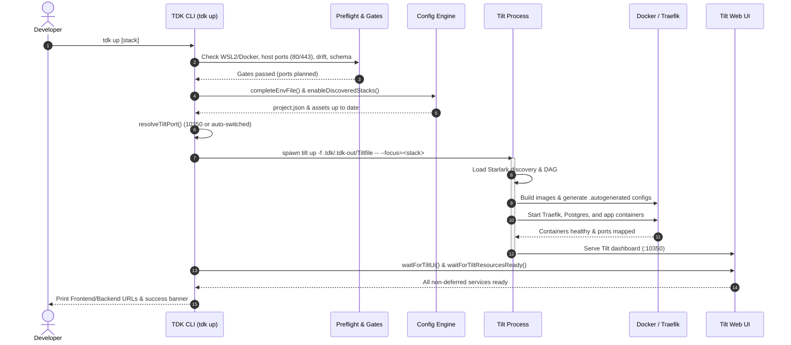

# How `tdk up` Works: What Happens Under the Hood

When you run `tdk up`, it appears to launch your services and open the Tilt dashboard in one simple step. Under the surface, however, the CLI performs environment verification, configuration compilation, dependency resolution, port collision avoidance, and process supervision before handing control over to Tilt and Docker.

Understanding this lifecycle helps developers debug issues quickly (for example, why an unassigned service did not boot, or why a port changed) and helps contributors modify the startup sequence safely.

---

## 1. Project Root Discovery & Runtime Asset Refresh

The startup routine begins in [cli/src/commands/up.ts](../cli/src/commands/up.ts):

1. **Locating the Project**: `findProjectRoot()` traverses up the filesystem from the current working directory to locate `.tdk/project.json`. If no project file is found, the command exits with `NOT_IN_PROJECT`.
2. **Platform & Host Preflight**:
   - **Native Windows**: TDK startup requires Linux containers on Docker (typically via Ubuntu on WSL2). Running directly under native Windows CMD or PowerShell without WSL2 is inspect-only unless `TDK_ALLOW_NATIVE_WINDOWS=1` is set.
   - **Container Hosts**: If running inside Dev Containers or Codespaces, TDK probes the Docker daemon socket to ensure container-in-container execution is viable.
3. **Environment Secrets Synchronization**: An older project may lack newly required secrets (such as `JWT_SECRET`). `completeEnvFile()` scans the project `.env` and generates any missing keys without overwriting existing secrets.
4. **Master Configs Generation**: If `.tdk/.tdk-out/Tiltfile` does not exist (for example, right after cloning or running `tdk import`), `tdk up` automatically calls `generateMasterConfigs()` to generate the Tiltfile, `spec.master`, and Starlark defaults from Handlebars templates.
5. **Runtime Asset Refresh**: `ensureProjectRuntimeAssets()` copies essential container scripts (such as `install-deps.sh`, `bun-hoisted-symlink-fix.sh`, `prisma-bun-client-link-fix.sh`, and `prisma-normalize-client.sh`) from `shared-platform-engineering/docker-templates/` into the project root so container builds are reproducible.

---

## 2. Auto-Enabling Discovered Stacks & Release Phases

A common pitfall in multi-service monorepos is adding a new service and wondering why `tdk up` skips it. TDK prevents this using automated stack discovery and phase registration:

### `enableDiscoveredStacks`
During startup, `enableDiscoveredStacks()` (in [cli/src/commands/project.ts](../cli/src/commands/project.ts)) searches all discovered `service.json` files for their declared `stack` names. Any stack that is not yet assigned to a phase in `.tdk/project.json` is automatically registered under the `pre_alpha` phase.

Why is this necessary? Tilt's Starlark engine evaluates services based on their stack assignment (`should_enable()`). If a stack was not listed in any phase, Tilt would boot core infrastructure but silently ignore the service.

### The Four Release Phases
In `.tdk/project.json`, services are organized into progressive development phases:

| Phase | Purpose | Default Behavior |
| :--- | :--- | :--- |
| `pre_alpha` | Core infrastructure and minimum viable services. | **Enabled by default** when running `tdk up` without a stack argument. |
| `alpha` | Essential business domain services. | Enabled when promoted or explicitly targeted. |
| `beta` | Extended features, background workers, and optional tools. | Enabled when promoted or explicitly targeted. |
| `out_of_scope` | Experimental, deprecated, or future services. | Disabled by default; excluded from normal startup. |

---

## 3. Choosing What to Start: Full Stack vs. `tdk up <stack>`

Developers can boot the whole environment or focus on a subset:

```bash
tdk up             # Starts all stacks configured in the active phase
tdk up shop        # Starts only the "shop" stack and its dependencies
tdk up --only api  # Starts only the "api" service and its dependencies
```

### Passing `--focus` to Tilt
When targeting a specific stack (`tdk up <stack>`) or specific services (`--only`), TDK constructs the Tilt command arguments in `buildTiltUpArgs()` ([cli/src/utils/tilt.ts](../cli/src/utils/tilt.ts)):

```bash
tilt up -f .tdk/.tdk-out/Tiltfile -- --focus=shop shop-api shop-worker
```

Notice the separator `--` followed by `--focus=shop`:
1. **Tilt Flag Isolation**: The Tilt CLI accepts only a fixed set of built-in flags (such as `--verbose` or `--watch`) and rejects unknown arguments. The `--` token instructs Tilt to stop parsing flags and pass subsequent arguments directly to the Tiltfile's Starlark `config.parse()`.
2. **Enabling vs. Waiting**: Bare positional arguments passed to `tilt up` only tell Tilt which resources to *wait on* in the terminal; they do **not** determine which resources the Tiltfile *enables*. Without `--focus`, Tilt evaluates its default phase and enables all stacks in that phase.
3. **Dependency-Aware Expansion**: Passing `--focus=<stack>` allows the Tiltfile's internal focus filter (`Config.apply_focus`) to perform topological dependency expansion, automatically booting dependent databases, caches, and cross-stack dependencies.

---

## 4. Routed URLs & Endpoint Resolution

Before booting containers, `tdk up` prints the public URLs where services will be reachable. These URLs are routed by the local Traefik reverse proxy container:

- **Frontend URLs**:
  - Base URL: `appBase` (derived from the HTTP ingress port, default `http://localhost:80` or `http://localhost:8080`).
  - Path: Taken from `service.json`'s `basePath` property (defaults to `/<service-name>`).
  - Health probe: Appends the health path (e.g. `http://localhost:80/storefront/health`).
- **Backend API URLs**:
  - Base URL: `apiBase`.
  - Path: Taken from `service.json`'s `apiPath` property (defaults to `/api/<service-name>` stripped of any `-api` suffix).
  - Sablier Deferred Tag: If a backend has Sablier cold-start deferral enabled (`sablier.enable: true`, `sablier.deferStart: true`), TDK prints:
    ```
    - orders-api: http://localhost:80/api/orders/health (deferred — starts on first request)
    ```
- Run `tdk networks` anytime to view the complete Traefik routing table across all running services.

---

## 5. Preflight Gates & Port Allocation

Before invoking Tilt, `tdk up` enforces several validation gates:

### Host Ingress Ports (80 / 443 / 5432)
The Traefik proxy and PostgreSQL database bind to standard host ports:
- HTTP Ingress: Preferred `80` (fallback range: `8080–8180`).
- HTTPS Ingress: Preferred `443` (fallback range: `8443–8543`).
- PostgreSQL: Preferred `5432` or `15432` (fallback range: `15432–15532`).

`getHostPortPlan()` probes these ports on `127.0.0.1`. If port 80 is occupied (for example, by Apache or another local tool), TDK automatically falls back to port `8080` and informs the developer:
```
Using fallback port 8080 for HTTP ingress (preferred port 80 is in use)
```
These can be explicitly overridden via environment variables: `TDK_HTTP_PORT`, `TDK_HTTPS_PORT`, and `TDK_POSTGRES_PORT`.

### Validation Gates
- **Drift Gate (`enforceDriftGate`)**: Checks if generated files under `services/*/*/.autogenerated/` were edited by hand. If manual edits are detected, startup halts with exit code `2` to prevent overwriting edits. Run `tdk config regenerate` or bypass with `--ignore-drift`.
- **Version Floor Gate (`enforceVersionFloor`)**: If `.tdk/project.json` defines a `minTdkVersion` and the installed CLI is older, startup halts with an upgrade prompt. Bypass with `--ignore-version`.
- **Schema & Service Config Gate**: Verifies `service.json` files against the JSON Schema, ensuring no duplicate service names, invalid port ranges, or circular `dependsOn` declarations exist.

---

## 6. The Tilt UI Port (Default 10350 & Collision Avoidance)

Tilt provides a web dashboard to monitor builds, logs, and container statuses:
- **Default Port**: `10350` (`STANDARD_PORTS.tiltUi`).
- **Collision Detection (`classifyTiltPorts`)**: TDK tests whether port 10350 is free. If a process is listening, TDK inspects the process:
  - If it is Tilt from the **same project**, running `tdk up` again connects seamlessly (or restarts with `--force`).
  - If it is Tilt from a **foreign project**, TDK warns that another project holds the port and automatically switches to the next free port (e.g. `10351`, `10352`).
- **Manual Override**: Set `TILT_PORT=<port>` to force a specific UI port. If an explicitly configured `TILT_PORT` is occupied by another project, TDK halts and asks you to pick a free port or stop the other stack.

---

## 7. Execution, Readiness & Failure Handling

Once all preflight gates pass, TDK launches Tilt and tracks startup progress:

```
Starting 4 services from all stacks...
Running tilt up...
Using Tiltfile: .tdk/.tdk-out/Tiltfile
```

### Readiness Supervision
1. **Tilt UI Polling**: `waitForTiltUi()` polls the Tilt web port until the HTTP endpoint responds (up to 30 seconds).
2. **Resource Build Tracking**: Once the UI responds, `waitForTiltResourcesReady()` monitors the build and run state of every declared service.
3. **Startup Stalled Reporting**: If a resource fails to build or crashes during startup, TDK diagnoses blocked downstream dependencies:
   ```
   orders-api failed: Docker build exited with code 1
   Blocked dependencies:
     - orders-worker (waiting on orders-api)
   ```
4. **Smoke Checks**: If any service configures a `smoke` URL check, TDK queries the public endpoint once Tilt reports readiness. If a smoke check fails, Tilt is stopped immediately to prevent running a broken stack.

### What Happens on Failure (`handleTiltFailure`)
If `tilt up` terminates abnormally, TDK catches the process exit code, prints `tilt up failed with exit code <code-number>`, and exits.

When troubleshooting startup failures:
- Run `tdk doctor` to perform a comprehensive diagnostic of Docker, Compose, and prerequisites.
- Check recent container logs with `tdk logs` or `tdk logs --json`.
- Open the Tilt Web UI (`http://localhost:10350`) to view full build logs and container backtraces.

---

## 8. Lifecycle Sequence Diagram



---

## 9. `tdk up` Cheat Sheet

### Command Flags

| Flag | Purpose | Example |
| :--- | :--- | :--- |
| `[stack-name]` | Starts only the specified stack and its dependencies. | `tdk up shop` |
| `--dry-run` | Validates configuration and prints the planned `tilt up` command without starting containers. | `tdk up --dry-run` |
| `-f, --force` | Kills existing Tilt process on this project's port before starting. | `tdk up --force` |
| `-v, --verbose` | Enables verbose diagnostic output and prints Starlark commands. | `tdk up --verbose` |
| `-q, --quiet` | Suppresses progress spinners, headers, and non-essential logs. | `tdk up --quiet` |
| `--only <services...>` | Starts only named services plus their required dependencies. | `tdk up --only api worker` |
| `--ignore-drift` | Bypasses drift check when generated service files differ from `service.json`. | `tdk up --ignore-drift` |
| `--ignore-version` | Bypasses `minTdkVersion` constraint in `.tdk/project.json`. | `tdk up --ignore-version` |
| `--json` | Emits a single JSON result object on stdout upon completion; implies `--quiet`. | `tdk up --json` |

### Environment Variables

| Variable | Default | Purpose |
| :--- | :--- | :--- |
| `TILT_PORT` | `10350` | Port for the Tilt Web UI dashboard. |
| `TDK_HTTP_PORT` | `80` (fallback: `8080`) | Host ingress port for Traefik HTTP routing. |
| `TDK_HTTPS_PORT` | `443` (fallback: `8443`) | Host ingress port for Traefik HTTPS routing. |
| `TDK_POSTGRES_PORT` | `15432` (or `5432`) | Host port for the shared platform PostgreSQL database. |
| `TDK_ALLOW_NATIVE_WINDOWS` | `0` | Set to `1` to bypass the native Windows WSL2 requirement. |

---

## 10. Shutting Down: How `tdk down` Works

The companion command [cli/src/commands/down.ts](../cli/src/commands/down.ts) safely tears down the running environment:

```bash
tdk down
tdk down --prune-networks
```

### Shutdown Steps
1. **Locate Project**: Finds `.tdk/project.json` and gets the path to `.tdk/.tdk-out/Tiltfile`.
2. **Stop `tilt up` First**: Before removing containers, `tdk down` finds and stops the running `tilt up` process (`stopProjectTiltUp()`). If `tilt up` were left running, its file watcher would immediately detect container removals and re-create them!
3. **Deregister Resources**: Calls `buildTiltDownArgs()` with `--focus` set to all stack names, ensuring that Tilt tears down all stack containers rather than only default pre-alpha services.
4. **Execute `tilt down`**: Spawns `tilt down -f .tdk/.tdk-out/Tiltfile`.
   > **Note on `--force`**: The Tilt CLI's `tilt down` command does **not** accept a `--force` flag. TDK accepts `tdk down --force` for script compatibility, but it has no effect. `tdk down` does not prompt for confirmation.
5. **Network Cleanup (`--prune-networks`)**: By default, Docker networks remain for quick restarts. Passing `--prune-networks` inspects and removes this project's isolated Docker networks (only if no active container is connected).

### `tdk down` Cheat Sheet

| Flag | Purpose |
| :--- | :--- |
| `-v, --verbose` | Prints verbose shutdown diagnostics and Tilt commands. |
| `-f, --force` | Accepted for script compatibility; has no effect. |
| `--prune-networks` | Removes project Docker networks that have no attached containers. |
| `--dry-run` | Displays what would be stopped without killing processes or containers. |
| `--json` | Emits a single JSON result object on stdout. |
