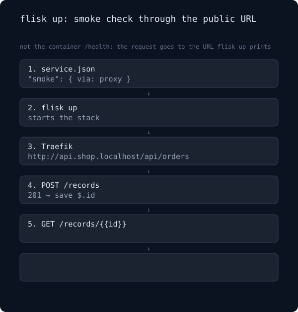

# 스모크 체크 (Smoke check)

> 이 문서는 [smoke.md](smoke.md)의 한국어 번역입니다.

`flisk up`은 컨테이너 내부뿐만 아니라 출력된 URL을 통해 서비스를 직접 검사할 수 있습니다. 아래 다이어그램은 동일한 경로를 두 번 실행합니다: 먼저 라우트가 정상 동작하고(201 반환 후 200 반환, "Smoke check passed"), 다음으로 다시 읽어올 때 404를 반환합니다("Smoke check failed", `flisk up` 종료 코드 1로 종료).

<p align="center">
  
</p>

GitHub의 blob 뷰에서는 애니메이션 없이 다이어그램이 표시되는 경우가 많습니다. 루프 애니메이션(약 16초: 성공 8초, 실패 8초)을 보려면 [원본 SVG 열기](assets/smoke.svg)를 클릭하세요.

```json
{
  "smoke": {
    "via": "proxy",
    "timeoutSeconds": 60,
    "steps": [
      { "name": "create", "method": "POST", "path": "/records", "body": { "name": "smoke" }, "expect": 201, "save": { "id": "$.id" } },
      { "name": "read back", "path": "/records/{{id}}", "expect": 200, "bodyContains": "smoke" }
    ]
  }
}
```

이 검사는 컨테이너의 `/health`가 아니라 `flisk up`이 출력하는 공개 URL을 대상으로 실행됩니다.

실패 라인에 표시되는 본문 스니펫은 터미널 출력을 위한 짧은 한 줄 요약이며 보관되지 않습니다. 보관되는 복사본은 실패 라인이 가리키는 `.flisk/smoke/<service>/<step-slug>/` 아래의 레코드(최대 64 KiB의 전체 본문 및 마지막 성공 응답)입니다.

화면에 표시되거나 저장되기 전에 텍스트 마스킹이 적용됩니다: 프로젝트 자체 `.env`에 정의된 시크릿 값(`flisk logs` 및 `flisk doctor`가 마스킹하는 값과 동일)은 `[REDACTED]`로 대체됩니다. 이는 저장된 본문, 마지막 성공 복사본, 출력된 스니펫, 레코드에 보관된 URL 및 오류 메시지에 모두 적용됩니다. 이는 시크릿 스캐너가 아닙니다: 오직 `.env`에 포함된 값만 대상으로 하므로, 읽을 수 있는 `.env`가 없는 프로젝트에는 마스킹할 대상이 없습니다. `.env`가 존재하지만 읽을 수 없는 경우 본문은 표시되거나 저장되지 않고 레코드에는 안전한 메타데이터만 유지되며, `flisk up`이 이를 안내합니다.

레코드는 기본적으로 git 추적에서 제외됩니다: `flisk up`은 첫 번째 레코드를 작성하기 전에 프로젝트의 `.gitignore`가 `.flisk/smoke/`를 무시하도록 설정되어 있는지 확인하고, 설정할 수 없는 경우 경고를 표시합니다. Git ignore는 예방적 조치일 뿐입니다: 이전에 이미 추가된 파일의 추적을 해제하지 않으며 이전 커밋에서 어떤 내용도 삭제하지 않습니다.

레코드는 `flisk down` 실행 후에도 유지되므로 컨테이너가 중지된 후에도 실패 기록을 확인할 수 있습니다. 이후 실행에서 덮어쓰거나 직접 삭제(`rm -rf .flisk/smoke/`)할 때까지 보존됩니다.

CI 환경에서는 `.github/workflows/e2e-journeys.yml`의 `smoke` 스위트가 실행 실패 시에도 일회용 검증 프로젝트의 레코드를 `smoke-records-*` 아티팩트(14일간 유지)로 업로드합니다. 워크플로 아티팩트는 해당 실행을 조회할 수 있는 모든 사용자가 읽을 수 있으므로, `.env`에 정의되지 않은 인증 정보를 응답으로 반환하는 스모크 단계에 워크플로를 연결하지 마세요.

모든 필드, 재시도 규칙 및 제외 사항은 [설정: `smoke`](configuration.md#smoke-check-the-public-url-after-flisk-up)에 기술되어 있습니다. `tests/e2e/journeys/smoke/verify-smoke.sh`는 실제 `flisk up`을 통해 두 가지 결과 경로를 모두 실행하여 검증합니다.
