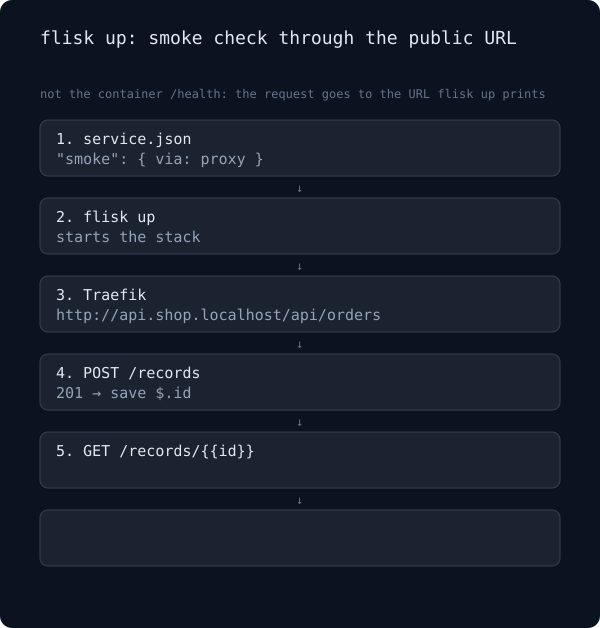

# Smoke check

`flisk up` can check your service through the URL it prints, not only inside the container. The drawing runs the same path twice: the route works (201, then 200, "Smoke check passed"), then the read-back returns 404 ("Smoke check failed", `flisk up` exits 1).

<p align="center">
  
</p>

GitHub's blob view often shows this drawing without the animation. [Open the raw SVG](assets/smoke.svg) to watch it loop (about 16 seconds: 8 for the pass, 8 for the fail).

```json
{
  "smoke": {
    "via": "proxy",
    "timeoutSeconds": 60,
    "steps": [
      { "name": "create", "method": "POST", "path": "/records", "body": { "name": "smoke" }, "expect": 201, "save": { "id": "$.id" } },
      { "name": "read back", "path": "/records/{{id}}", "expect": 200, "bodyContains": "smoke" }
    ]
  }
}
```

The check hits the public URL that `flisk up` prints, not the container's `/health`.

The body snippet in a failure line is a short, one-line excerpt for the terminal and is not kept. The retained copy is the record under `.tdk/smoke/<service>/<step-slug>/` (full body up to 64 KiB, plus the last passing response), which the failure line points to.

Before anything is shown or stored, the text is masked: the secret values of the project's own `.env` — the same ones `flisk logs` and `flisk doctor` mask — are replaced with `[REDACTED]`. That covers the stored body, the last-success copy, the printed snippet, and the URL and error kept in the record. It is not a secret scanner: it covers the values the `.env` holds, and nothing else, so a project without a readable `.env` has nothing to mask. If the `.env` exists but cannot be read, the body is neither shown nor stored, the record keeps only the safe metadata, and `flisk up` says so.

The records are ignored by default: `flisk up` makes sure the project `.gitignore` ignores `.tdk/smoke/` before it writes the first record, and warns when it cannot. Git ignore is preventive only: it does not untrack files that were added before, and it does not take anything out of earlier commits.

The records survive `flisk down`, so a failure can still be read after the containers stop. They stay until a later run overwrites them or you delete them: `rm -rf .tdk/smoke/`.

In CI, the `smoke` suite of `.github/workflows/e2e-journeys.yml` uploads the records of its throwaway verify project as a `smoke-records-*` artifact (14 days), even when the run fails. A workflow artifact is readable by anyone who can read the run, so do not point a workflow at a smoke step whose response echoes a credential the `.env` does not hold.

Every field, the retry rules and what is not covered are in [Configuration: `smoke`](configuration.md#smoke-check-the-public-url-after-flisk-up). `tests/e2e/journeys/smoke/verify-smoke.sh` runs both outcomes through a real `flisk up`.
