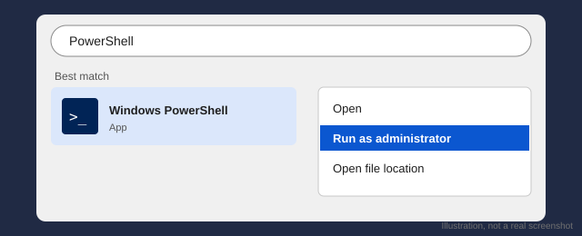
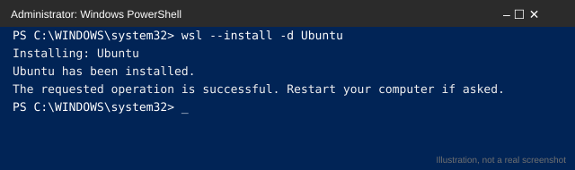
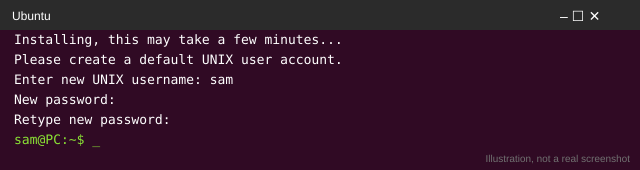
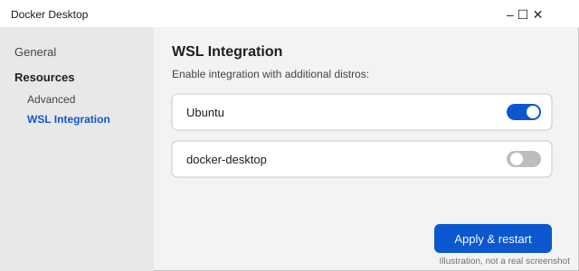
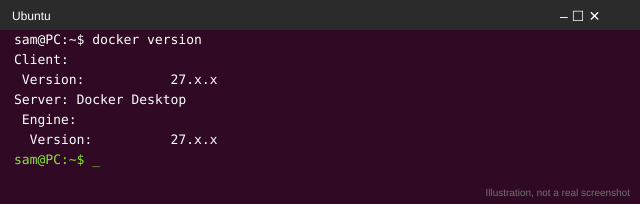
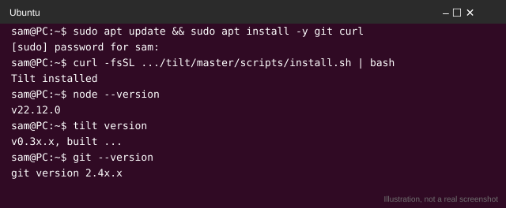
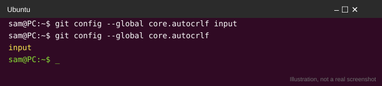
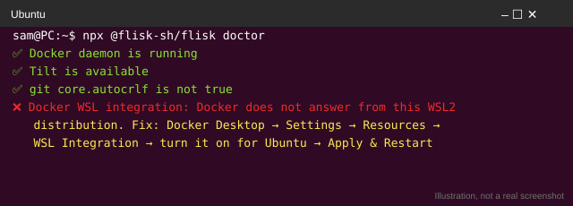
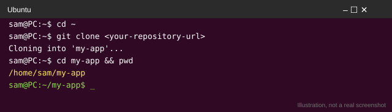

# Start here on Windows

[← Back to the README](../README.md) · [Words you'll see](start/words.md)

Windows cannot run the full Flisk stack by itself, so `flisk doctor` tells you to use Ubuntu on WSL2. This page puts every step in one place, in the order that worked for a first-time user on Windows 10, with what `flisk doctor` prints when a step is missing.

Short on time? The two-service demo (`npx @flisk-sh/flisk demo`) runs on plain Windows without any of this. You need the steps below for the full Docker stack. [Windows & WSL2](wsl2.md) has the reference version.

**One command instead:** in PowerShell, this runs steps 1 and 3 to 6 for you and checks step 2, skipping whatever is already done. Pass your repository's URL to clone it into Ubuntu as well:

```powershell
& ([scriptblock]::Create((irm https://raw.githubusercontent.com/flisk-sh/flisk/main/scripts/windows/setup-wsl.ps1))) -Repo https://github.com/<you>/<your-repository>
```

It stops with one next step when something needs you: PowerShell as administrator to install Ubuntu (then a restart), or turning on Docker Desktop's WSL integration. The steps below are what it does, one by one.

| Step | Where you type it | Done when |
|------|-------------------|-----------|
| [1. Install Ubuntu](#1-install-ubuntu-on-wsl2) | PowerShell as administrator | The Ubuntu app opens |
| [2. Connect Docker Desktop](#2-connect-docker-desktop-to-ubuntu) | Docker Desktop | `docker version` works in Ubuntu |
| [3. Install Node.js, Tilt and Git](#3-install-nodejs-tilt-and-git-in-ubuntu) | Ubuntu | The three version commands print a version |
| [4. Keep line endings as LF](#4-keep-line-endings-as-lf) | Ubuntu | `git config --global core.autocrlf` prints `input` |
| [5. Run `flisk doctor`](#5-run-flisk-doctor) | Ubuntu | Every check passes |
| [6. Clone inside Linux](#6-clone-inside-the-linux-filesystem) | Ubuntu | `pwd` starts with `/home/` |

## 1. Install Ubuntu on WSL2

Open the Start menu, type `PowerShell`, right-click **Windows PowerShell** and choose **Run as administrator**.


*Illustration: search for PowerShell, then pick Run as administrator.*

In PowerShell, paste:

```powershell
wsl --install -d Ubuntu
```


*Illustration of what you should see. Your window may look slightly different.*

Restart if Windows asks. Then open the **Ubuntu** app from the Start menu and choose a user name and password (the password stays invisible while you type).


*Illustration of what you should see.* From here on, type every command in the Ubuntu app, not in PowerShell.

**If you skip it:** in PowerShell or `cmd`, `flisk doctor` prints

```
Native Windows cannot boot a Docker stack; services that declare a command run as local processes. For a Docker stack use WSL2 Ubuntu with Docker Desktop integration.
```

and `flisk up` on a Docker project exits with `Landscape startup needs Ubuntu on WSL2.` Open Ubuntu and run the same command there.

## 2. Connect Docker Desktop to Ubuntu

Install [Docker Desktop](https://www.docker.com/products/docker-desktop/) with the WSL 2 backend. Then open **Settings → Resources → WSL Integration**, turn it on for **Ubuntu**, and click **Apply & Restart**. Check in Ubuntu:


*Illustration of what you should see. Your window may look slightly different.*

```bash
docker version
```


*Illustration of what you should see.*

**If you skip it:** `flisk doctor` in Ubuntu reports `Docker WSL integration` as failed:

```
The docker command is not available in this WSL2 distribution.
Docker does not answer from this WSL2 distribution.
```

The fix it prints is the one above. Start Docker Desktop first if it is not running.

## 3. Install Node.js, Tilt and Git in Ubuntu

Flisk needs Node.js 22.12 or newer, [Tilt](start/words.md#tilt) and Git inside Ubuntu. They are separate from anything installed on Windows.

```bash
sudo apt update && sudo apt install -y git curl
curl -fsSL https://raw.githubusercontent.com/tilt-dev/tilt/master/scripts/install.sh | bash
```

Install Node.js 22 or newer from [nodejs.org](https://nodejs.org/en/download) (choose Linux) or with your usual version manager, then check all three:

```bash
node --version   # v22.12.0 or newer
tilt version
git --version
```


*Illustration of what you should see.*

**If you skip it:** `flisk doctor` prints `Tilt CLI not found` with the install command as its fix. A missing Node.js shows up earlier: `npx: command not found` or `node: command not found` in Ubuntu means step 3 is not done.

## 4. Keep line endings as LF

Windows Git can rewrite shell scripts and healthchecks with CRLF line endings, which Linux containers cannot run. Tell Git to keep LF:

```bash
git config --global core.autocrlf input
```


*Illustration of what you should see.*

Run it in Ubuntu. If you also use Git on Windows, run it in PowerShell as well.

**If you skip it:** `flisk doctor` warns `git core.autocrlf is true; generated files may get CRLF while Docker Linux containers expect LF`. Scripts that were already cloned with CRLF stay broken: set the option, then clone again.

## 5. Run `flisk doctor`

In Ubuntu:

```bash
npx @flisk-sh/flisk doctor
```


*Illustration: a failed check prints the fix right below it.*

Fix anything it marks failed, using the fix it prints, then run it again until every check passes. Other messages and what they mean are in [Windows & WSL2: Troubleshooting](wsl2.md#troubleshooting).

## 6. Clone inside the Linux filesystem

Clone and work under your Ubuntu home folder (`~/…`), not under `/mnt/c`:

```bash
cd ~
git clone <your-repository-url>
cd <your-repository>
pwd   # should print /home/<you>/…
```


*Illustration of what you should see.*

Files under `/mnt/c` are on the Windows disk, where file watching and permissions are slow or wrong, so live reload lags and scripts can lose their executable bit. To open the folder in Windows, type `explorer.exe .` in Ubuntu or browse to `\\wsl$\Ubuntu\home\<you>`.

## Next

```bash
flisk up
```

Never written code? [Start here](start/first-time.md). Stuck? See [Windows & WSL2](wsl2.md#troubleshooting) or the [Windows setup](setup/windows.md).
